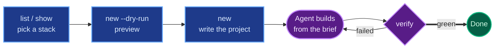
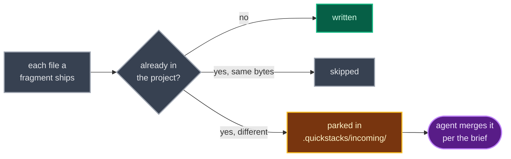

# Quick start

This guide takes you from nothing to a project your coding agent is building, in about five minutes. You'll install the CLI, pick a stack, preview it, write the project, and run the check that says when it's done.

quickstacks does the setup work that's easy to get subtly wrong: picking the pieces, laying out the project, and writing down what "working" means. Your coding agent (Claude Code, Codex, OpenCode or Cursor) does the building. The CLI never writes application code and never runs an install script; it writes a few starter files and a brief, and the agent takes it from there.



The blue steps are yours, and this guide walks through each one. The purple loop is the agent's.

## What you need

- [Bun](https://bun.sh) 1.4.2 or newer, to build the CLI.
- git.
- A coding agent CLI on your PATH, if you want quickstacks to hand the project over for you. `claude`, `codex`, `opencode` and `cursor-agent` are recognized.
- Whatever the stack builds with. A Go stack needs Go, a Python stack needs uv, and so on. quickstacks tells you if something is missing; it never fails because of it.

## Get the CLI

quickstacks isn't on npm yet, so you build it from this repository:

```sh
git clone <this repository> quickstacks
cd quickstacks
bun install
bun run build
```

The binary is `packages/cli/dist/quickstacks`. Put it on your PATH with a symlink, not a copy. The binary finds its bundled stacks in `packages/cli/registry/` next to its real location, and a copy elsewhere can't see them:

```sh
mkdir -p ~/.local/bin
ln -s "$PWD/packages/cli/dist/quickstacks" ~/.local/bin/quickstacks
quickstacks --version
```

If `--version` prints a version, you're set. `quickstacks doctor` shows where it looks for everything, if you ever need to check.

Once quickstacks is published, `npx quickstacks <command>` will do the same thing with no clone. Every command below works either way.

## Pick a stack

A stack is a recipe for one kind of project: a Go CLI, an Astro blog, a FastAPI backend with a React frontend. List them:

```sh
quickstacks list stacks
```

```text
Stacks
  astro-blog               proven 2026-10-27
    A static Astro blog with MDX posts in a zod-validated content collection ...
  go-cli                   proven 2026-10-27
    A Go command-line tool with cobra commands, viper config ...
  typescript-cli           proven 2026-10-27
    A Bun-compiled TypeScript CLI with Effect commands and services ...
```

"proven" means a coding agent built that stack's default setup from scratch on that date and every check passed. "unproven" means nobody has recorded such a run yet.

Read one before you commit to it:

```sh
quickstacks show typescript-cli
```

`show` prints everything the stack would tell your agent: the layout it wants, the decisions it will ask about, the checks that define done, and the files it ships. It only reads; nothing runs.

This guide uses `typescript-cli`. Swap in any stack id.

## Preview the project

Ask for a dry run first. It does everything except write:

```sh
quickstacks new typescript-cli my-cli --sandbox --dry-run
```

```text
Planned my-cli from typescript-cli (sandbox).
Fragments: agent-ops, ci-github, claude-harness, effect-schema, effect, git-hooks
Agents: claude
Git: would create a new repository
Would write 58 files:
  ...
Brief: .quickstacks/BRIEF.md (4666 words)
Dry run: nothing was written.
```

Two things in that output are worth understanding.

The `Fragments:` line lists the add-ons this stack pulls in. A fragment is one capability, such as CI, git hooks or a database, that several stacks can share. `typescript-cli` includes some by default; `list fragments` shows the rest, and `--with` and `--without` change the set.

`--sandbox` means "local only". The agent takes the default for every decision instead of asking you, and nothing gets deployed or released. It's the fastest way to see a stack working. Drop `--sandbox` when you want to make the decisions yourself.

## Write the project

Run the same command without `--dry-run`:

```sh
quickstacks new typescript-cli my-cli --sandbox
```

quickstacks writes the starter files, creates a git repository, and then starts your coding agent in `my-cli/` with one instruction: read the brief and carry it out. You'll be talking to the agent from here on.

If you'd rather start the agent yourself, add `--no-launch`. quickstacks then prints the prompt to give it:

```text
Next: open /path/to/my-cli in your coding agent and give it this prompt:
  Read .quickstacks/BRIEF.md and carry it out. It's your full task for this project; you're done when quickstacks verify passes.
```

## What landed in your project

Most of what `new` wrote is ordinary project files: `README.md`, `AGENTS.md`, config for your agent under `.claude/`, a CI workflow. The interesting part is `.quickstacks/`:

| File | What it is | Committed? |
| --- | --- | --- |
| `BRIEF.md` | The agent's task: what to build, which decisions to ask about, and the checks that must pass | No |
| `manifest.json` | The project's record: which stack and fragments it came from, and its verify steps | Yes |
| `NOTES.md` | Where the agent writes down questions it asked and problems it found with the brief | No |
| `state/` | Verify's run history | No |

The brief is long (thousands of words) because it's written for the agent, which reads all of it. You don't need to read it, but skimming its "Decisions" and "Definition of done" sections tells you what you're getting.

## Run verify

`verify` is the definition of done. It runs the checks listed in the manifest (install, lint, typecheck, tests, and whatever else the stack and its fragments require) and reports which pass:

```sh
cd my-cli
quickstacks verify
```

Run it straight after `new`, before the agent has built anything, and it fails at the first step, which is expected:

```text
verify: failed (full run; 0 passed, 1 failed, 12 skipped; 0.0s)

  failed   setup     install               (exit 1, 0.0s)  exited with status 1
      | error: Bun could not find a package.json file to install from
  skipped  check     lint                  an earlier setup step failed
  ...

Next: fix the code or config these steps exercise, not the steps, then run quickstacks verify again.
```

The agent runs this same command in a loop: fix what failed, run again. When every step passes, verify prints `verify: green` and exits 0, and the project is done.

Two rules keep that honest. The agent may not edit the steps, and verify checks this itself: before running anything, it compares the steps against a copy recorded when the project was made, and refuses to run if they differ. If you change a step on purpose, accept the change from your own terminal:

```sh
quickstacks verify --accept-changes
```

An agent can't run that command; it's refused whenever an agent is detected.

## Check the history

```sh
quickstacks runs
```

`runs` summarizes every verify run for this project: how many there were, the last outcome, how long it took to reach the first green run, and how many questions the agent had to ask you.

## Add fragments to a project you already have

quickstacks works on existing repositories too. `add` applies fragments without overwriting anything:

```sh
cd my-existing-repo
quickstacks add ci-github git-hooks
```



New files are written. When a file already exists, quickstacks leaves it alone and parks its own version under `.quickstacks/incoming/`, and the brief asks your agent to merge the two. Then `verify` checks the whole project, the same as for a new one.

`quickstacks list fragments` shows what you can add. Inside a project quickstacks made, plain `quickstacks list` shows only the fragments that fit it.

## Let your agent drive instead

Everything above also works the other way round: you ask your agent for a project and it runs quickstacks. Install the skill once:

```sh
quickstacks skill install
```

That puts a short skill file where Claude Code finds it (`~/.claude/skills/quickstacks/SKILL.md`). Then, in any Claude Code session, ask for something like "start me a Go CLI with tests and CI". The agent picks a stack, tells you which and why, writes the project and builds it until verify passes. [Using quickstacks with an agent](agents.md) covers other agents and what the agent sees.

## Where to go next

- [Concepts](concepts.md) explains stacks, fragments, the brief and verify properly.
- [Command reference](reference/commands.md) lists every flag.
- [Authoring](authoring.md) shows how to write your own stack or fragment.
- `quickstacks <command> --help` gives any command's flags, exit codes and examples.
