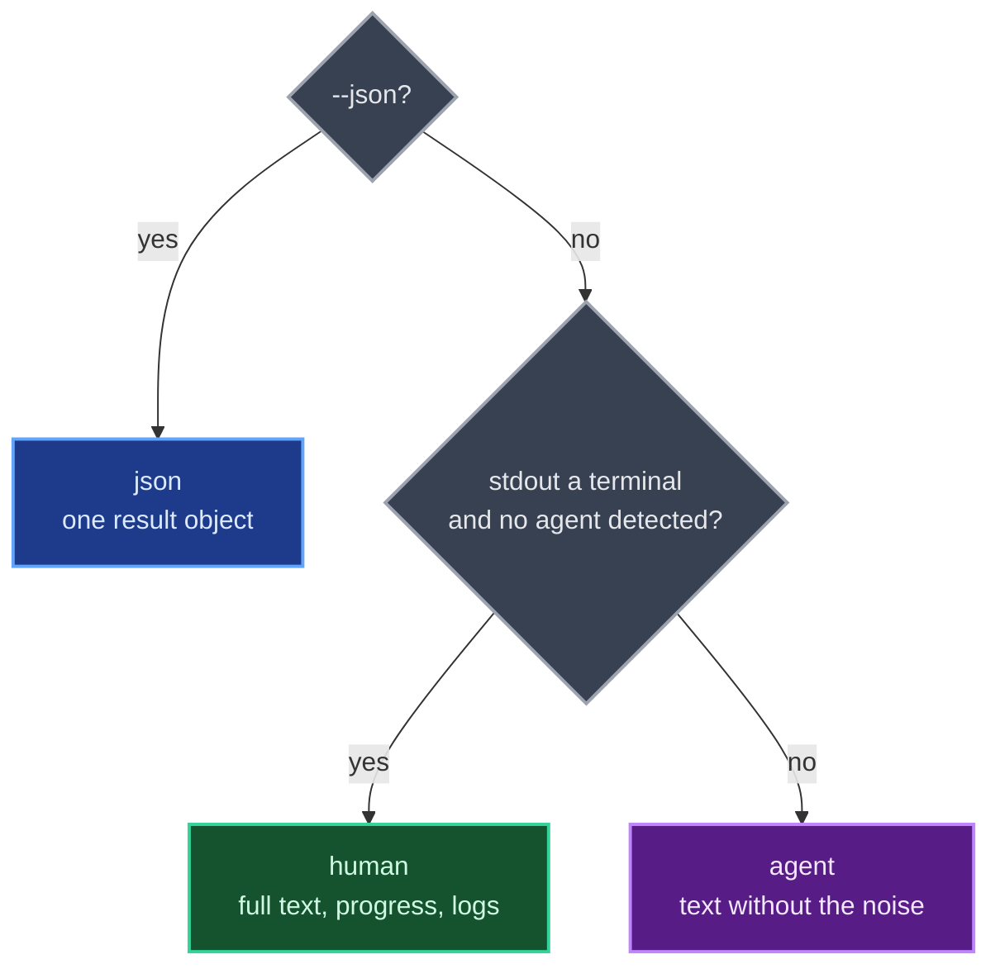

# Output and errors

This is the contract every command keeps: who the output is for, what goes to stdout and stderr, the error envelope, the exit codes, and what signals do. It's the one place in the docs these tables live.

## Three audiences

Output has three audiences, picked once per invocation. `--json` is the machine contract below. Without it, the output is for a human only when stdout is a terminal and no coding agent is detected (`CLAUDECODE`, `AI_AGENT` and the other markers in `src/config.ts`); everything else (an agent's shell, a pipe, CI) gets agent output, the default.



The two text renderings carry the same result with the same exit code and files; agent output leaves out what an agent doesn't need:

- No log lines on stderr (they go only to `QUICKSTACKS_LOG_FILE` when it is set), so stderr is the failure message and its detail lines.
- Paths in a command's result text print relative to the working directory when inside it, absolute otherwise. Paths in error details (`Path:`, `Looked for:`) stay absolute for now, and `--json` keeps every path absolute.
- `new`: no written-file listing (the brief lists the files), no absolute `Project:` line, and no `For example:` command after a printed prompt (it repeats the prompt).
- `verify`: no rows for passed steps (the summary counts them) and none on a `changed` run, where every step is skipped for the same reason and the error lists the change. Failed and skipped rows, output tails and the `Next:` line stay, and the per-command progress lines are human-only.
- The guide: a human first gets one line saying it is written for agents and how to start a project yourself.
- `validate`: only the size rows over their limit (a human sees the whole table; `--json` keeps every size).
- `list`: each description on one line, not wrapped.

## Streams and the error envelope

Stdout contains results only. `--json` emits one result object; JSON version is `{ "version": "0.1.0" }` and JSON help is `{ "help": "..." }`. Failures leave stdout empty, and stderr holds a safe diagnostic, or with `--json` exactly one envelope as the last stderr line:

```json
{ "error": { "tag": "NotFound", "message": "Not found.", "retryable": false, "details": { "kind": "project", "looked": "/path", "suggestions": [] } } }
```

`message` is fixed per tag, so it's safe to match on. `details`, when present, is a closed per-tag object holding only values the CLI produced or arguments you passed (for example `{ "command", "suggestions" }` for an unknown subcommand). Text modes print the message, the detail lines indented under it, and usually a `Next:` line.

Two exceptions keep stdout. A failure that carries a report (`VerifyFailed`, `VerifyChanged`, `ValidationFailed`) writes that report to stdout before the error. A command that hands the terminal to another program writes its output so far before doing so, which stays on stdout if it later fails.

In JSON and agent output, ancillary logs go only to the optional log file, so stderr stays parseable and short; set `QUICKSTACKS_LOG_FILE`, or rerun at a terminal, to see why a `Defect` happened. A `--json` after `--` belongs to the command, not to quickstacks. Human output emits logs to stderr and optionally to the same JSONL file. No command streams results.

## Exit codes

Each exit code means one next action, and a published code never changes meaning.

| Exit | Tags | Next action |
| --- | --- | --- |
| 0 | | Success. For `verify`, check the outcome: `partial` is exit 0 but not done |
| 1 | `Defect` | A bug in quickstacks; not retryable |
| 2 | `Usage`, `BadInput`, `NotFound`, `EntryInvalid`, `ComposeConflict`, `TargetNotEmpty`, `ValidationFailed` | Fix the input. `ValidationFailed` keeps its report on stdout |
| 3 | `NotConfigured`, `InvalidConfig` | Fix the configuration or manifest, or upgrade quickstacks for a newer schema |
| 4 | `UpstreamUnavailable` | Retry later |
| 5 | `VerifyFailed`, `VerifyChanged` | Read the verify report on stdout |
| 6 | `PermissionDenied` | Ask a person |
| 130 | `Interrupted` | The run was stopped; cleanup ran |

After `new` launches an agent, the exit is that agent's own status (128 plus the signal number if a signal killed it), outside this table. A closed stdout pipe exits quietly with 0, except after a failure that keeps its report, which keeps its exit (2 for validate, 5 for verify), so a failed verify piped into `head` never reads as a pass. Defects never become success.

## Signals

Ctrl+C (SIGINT), SIGTERM or SIGHUP stops the command after its cleanup, with exit 130, and the processes it started are killed. A second Ctrl+C within a second of the first is treated as the same keypress (a wrapper such as `bun run dev` or `npx` forwards a copy); one a second or more later exits at once, killing those processes without further cleanup.

While quickstacks has handed the terminal to another program (an agent launched by `new`), Ctrl+C and SIGQUIT belong to that program, and SIGTERM and SIGHUP are passed on to it; once that program exits, quickstacks stops too, with exit 130.

Processes started by `verify` run in their own process group. On interruption, timeout or the end of a step, the group gets SIGTERM, then SIGKILL after 5 seconds.
