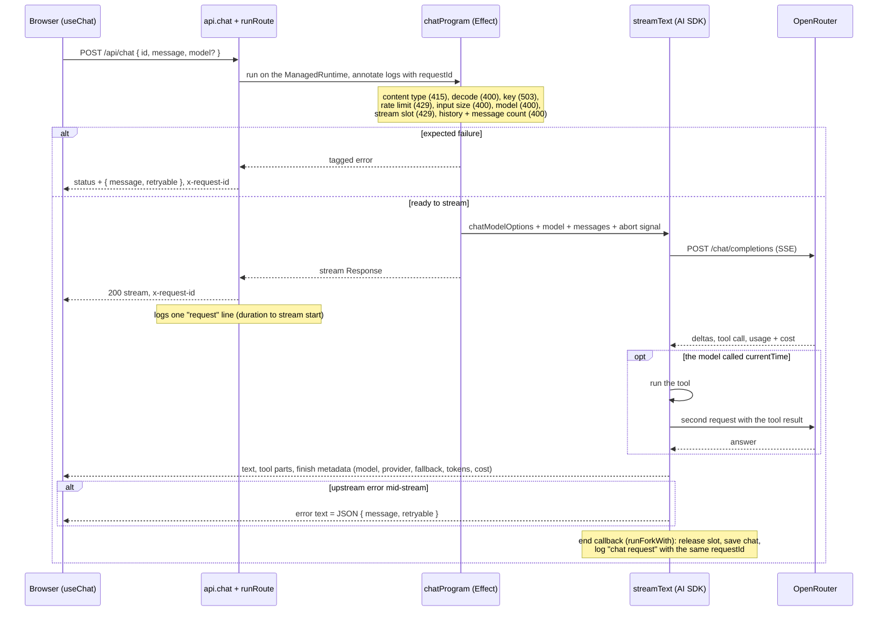

# One chat turn

How a chat request moves through the app, and which harness layers catch the mistakes specific to chat. With the Claude adapter installed, the general layer table is in [`harness.md`](harness.md).

Effect owns everything before the stream, and every failure there is an HTTP error with `{ message, retryable }`. The AI SDK owns the stream. Work that outlives the Response runs from the SDK's callbacks, forked onto the runtime.



The code is `app/routes/api.chat.ts`, `app/.server/http.ts` (`runRoute`), and `app/.server/chat.ts` (`chatProgram`, `userSafeStreamError`). The error and abort callbacks also release the slot, so a stream that fails or is cancelled can't hold one.

## Layers for chat mistakes

| Mistake | Prevention | Blocked or flagged | Backstop |
| --- | --- | --- | --- |
| Off-system styling (`text-[13px]`, palette colors, ungated motion) | `styling.md` rule, `DESIGN.md` | `lint-on-write.sh` hands the `styling.grit` diagnostic back seconds after the edit | the lint command, pre-commit Biome, CI |
| Stream format and `useChat` disagree after an AI SDK upgrade | `ai-sdk.md` rule: read the installed `.d.ts` first | `tests/chat-closed-loop.test.tsx` renders `Chat` against the real `api.chat` action | the app's browser e2e, CI |
| A hydration mismatch | none | the browser e2e fails on any console error | CI |
| Stub drift: OpenRouter's real stream format moves away from the hand-written stub | `openrouter.md` rule | `tests/openrouter-replay.test.ts` replays recorded OpenRouter bodies through the real provider, whole and in 7-byte chunks | `bun run record:openrouter` re-records them (manual, needs a key, a fraction of a cent) |
| A model regression: a new model or prompt stops calling the tool, or extracts the wrong fields | none | `bun run eval --models a,b` runs the cases in `evals/cases.ts` (chat and extract) through the app's own chat options and `extractContact` | manual only: needs a key and costs money |

Neither the evals nor the recorder runs in CI: CI has no `OPENROUTER_API_KEY`, and no test can reach the network. The replay test does run in CI, against whatever fixtures were last recorded. Re-record when you upgrade `@openrouter/ai-sdk-provider` or `ai`, or when OpenRouter announces a stream change; if the replay test then fails, the provider no longer parses what OpenRouter sends.

## Try it

With the dev server running (`bun run dev:bg` prints its URL), a request with the wrong content type shows the error path and the logs together:

```bash
id=$(curl -si "$URL/api/chat" -d hi | awk 'tolower($1)=="x-request-id:" {print $2}' | tr -d '\r')
jq -c --arg id "$id" 'select(.requestId == $id)' logs/server.jsonl
```

The log line has `status`, `durationMs`, `errorTag: "UnsupportedMediaType"`, and the same message. With a key set, a real chat turn adds a `chat request` line with the served model, provider, tokens, and cost under the same `requestId`. Without a key, the chat page says chat is off and Send is disabled. `bun run eval --models <model-a>,<model-b>` (needs a key) prints a table per model and case and writes `evals/results/<timestamp>.json`.
