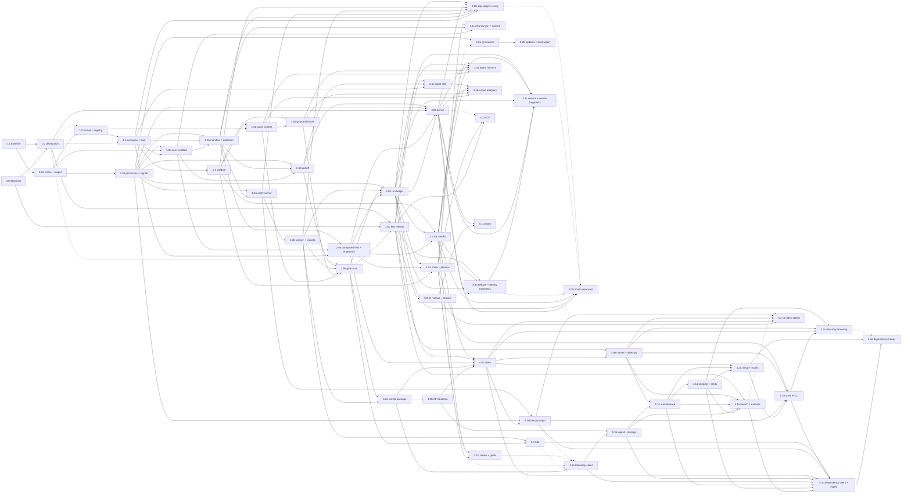

# Roadmap: phases and sub-phases

Status: DRAFT 2026-10-26, written to the demo-first proposal (D23). Proposed, not agreed
with the maintainers.
Settled decisions are only in the [README decisions log](README.md#decisions-log);
proposals are in [requirements.md](requirements.md#proposed-decisions).

## TL;DR

Six phases. Phases 0 and 1 are the MVP: the core loop from the problem statement, run
from the repo or the compiled binary, over the bundled catalog. The MVP is the demo.
Packaging for npm (0.2), reserving the name and publishing (1.6c) are the final step
before public release, after the [feature gaps](#feature-gaps-to-close-before-release)
are closed. After it, the order is local proof, then reach, then scale, then automation:

1. Phase 2: stacks prove themselves on a maintainer's machine. Run records, a ledger, a
   fingerprint, a bench that drives the user's own agent headlessly, and the
   deterministic checks that catch rot without an LLM.
2. Phase 3: existing repos and authors. `add`, personal and team stacks, authoring
   tools, (only once someone outside asks) git sources, and a wider bundled catalog with
   native config for more agents and apps built on stacks.
3. Phase 4: the hosted side. An Effect API in `packages/api` that serves a signed
   registry index, opt-in or opt-out usage telemetry (the maintainers' call) with
   integrity checks and a launch runbook, public stats, a browsable directory, dependency
   trends, and an MCP server in `packages/mcp` once there is evidence agents want one.
4. Phase 5: CI and scheduled inference. The release workflow with provenance, extra CI
   jobs, the scheduled canary, and building, signing and deploying the index from CI.
   Everything here waits so the demo comes sooner (D23); the local behavior the earlier
   phases build stays where it is.

Every sub-phase is one file in [phases/](phases/), sized for one agent in one session.

## How the files are numbered

`phases/phase-<phase>.[letter]-<slug>.md`, for example
`phase-1.4-handoff-and-entry-points.md`. The phase number is the release-level
grouping. The sub-phase number starts at 0 in every phase, and `.0` is the spine: the
sub-phase the rest of the phase builds on. Higher numbers are not a strict order; the
dependency graph below says what can run in parallel. A sub-phase that is too big for one
session splits by appending a letter to its number and keeping a slug, for example
`phase-1.3a-verify-runner-and-probes.md` and
`phase-1.3b-tamper-detection-and-run-records.md`. The numbers of its siblings never change,
the same way decision IDs never change, and a split sub-phase has no file with the bare
number. Letters are not an order either: 1.6d runs before 1.6b, and 2.0c before 2.0b.

Phase 2 has no 2.1: scheduled reruns are phase 5 (5.1, under D23).

Each sub-phase file opens with its `Status:` line, then a table of goal, traces to,
depends on, blocks and decisions needed, then scope, design, files touched, acceptance
tests, exit criteria and what the plan may get wrong. Exit criteria always include
`bun run check` from the repo root. A sub-phase that uses a contract from
[Contracts every sub-phase shares](#contracts-every-sub-phase-shares) cites it by name and
never restates it.

## MVP cutline

The MVP is everything in phases 0 and 1, and nothing else. It is done when all of this is
true:

- `quickstacks list --json` works from the repo (`bun run dev`) or the compiled binary on
  macOS and Linux. `npx quickstacks@latest` (D12, D22) is the release step's, not the
  MVP's.
- `quickstacks new <stack> <dir> --sandbox` writes the starter files,
  `.quickstacks/BRIEF.md` and `.quickstacks/manifest.json`, runs no command from any
  entry, and hands off to the agent on PATH, to the agent that called it, or prints the
  prompt.
- `quickstacks verify` runs the manifest's steps in phases, probes dev servers, always
  runs teardown, and fails (not warns) when the steps were changed since `new` wrote them
  (D14, proposed).
- `quickstacks validate` enforces the brief budget (D5) and the verify layers (D7) on the
  bundled registry, and the bundled registry passes it with zero errors and zero warnings.
- The gate rule (D20, proposed): every bundled stack has at least one recorded
  `new --sandbox` run that reached a green `verify` with zero interventions and
  `tamperCheck: "full"`, with its time to green, time to first passing test, verify count,
  brief size and repo commit written down. Two of three green on the first attempt is the
  success-rate target, not the gate. One stack's composed brief is near 3,000 words and
  one is near 5,000 (D13), so the long-brief assumption gets a first data point.
- A2-A4 are in the README decisions log before the package is published, because exit 5,
  the `details` envelope and the signal policy are permanent once agents depend on them.
- Publishing is not part of the MVP. A maintainer publishes to npm by hand (1.6c) as the
  final step before public release, after 0.2 packs the CLI and the name is reserved. The
  tag-driven release workflow and npm provenance are phase 5 (5.0).

Below the cutline, on purpose: `add`, `show`, `new --dry-run` and the naming options
(3.1c), authoring skeletons, the agent skill (3.4c), the rot checks beyond budget and
layers (2.2), third-party sources, the bench, telemetry, the API, the MCP server, and
every CI change. Some of these must still land before the public release; they are listed
in [Feature gaps to close before release](#feature-gaps-to-close-before-release).

## Phases and sub-phases

### Phase 0: foundation

Goal: the name is held, the decisions that are hard to reverse are made, the package can
be installed with `npx`, and the CLI base can run long and interactive commands. No
product behavior yet.

| Sub-phase | Goal | Traces to | Depends on | Status |
|---|---|---|---|---|
| [0.0 Decisions and name](phases/phase-0.0-decisions-and-npm-name.md) | `quickstacks` reserved on npm; the MVP-gating proposals decided or deferred with a reason; A2-A4 reviewed; first stack named | Open question "Is the npm name available?"; open questions on brief budget and registry audience | nothing | In progress (owner: maintainers). Name check done; npm reservation and non-blocking decisions deferred 2026-10-26 |
| [0.1 Repo baseline](phases/phase-0.1-repo-baseline.md) | The ported base, workspace move and review fixes committed, CI `ci-ok` green on `main` | "What has to be true for it to be worth building": a trustworthy base (D10, D11) | nothing | Executed 2026-10-26 |
| [0.2 Distribution](phases/phase-0.2-npm-distribution-artifact.md) | A1 answered: a Node ESM bundle packed with `bun pm pack`, a Node floor check before Effect loads, bundled assets found at runtime, local e2e against the packed tarball | Open question on the npm name; the README's first command `npx quickstacks new` | 0.0 (A1, D12, D22), 0.1 | Deferred 2026-10-26 to the final step before public release, with the npm reservation and 1.6c (see below) |
| [0.3a Errors and output](phases/phase-0.3a-errors-and-output.md) | A2 and A4: one error table, closed `details`, exit 5, results kept on report-carrying failures, live progress on stderr | Agent as the main reader ("a verify command that doesn't exist", "ambiguity") | 0.1 | Executed 2026-10-26 |
| [0.3b Processes and signals](phases/phase-0.3b-processes-and-signals.md) | The `Processes` service (process groups, bounded tails, drain, `which`) and A3, the signal policy for interactive children | The CLI hands off "to the agent the user already has"; verify runs long commands | 0.3a | Executed 2026-10-26 |

0.2 keeps its number but runs last: on 2026-10-26 the maintainers deferred distribution
because the prototype runs from the repo. Packaging (0.2), reserving the npm name (0.0)
and publishing (1.6c) are together the final step before public release, after the
[feature gaps](#feature-gaps-to-close-before-release) are closed; none of them comes
before 1.6b. Until then phase 1 uses the stubs its files already describe (a stub
registry path, `Host.invocation` fixed to `quickstacks`), and 1.6b's gate runs use the
compiled binary, or a packed tarball if 0.2 has landed by then.

### Phase 1: the core loop (MVP)

Goal: an agent can run `list --json`, `new --sandbox`, read the brief and loop on `verify`
to green on the bundled stacks, from the repo or the compiled binary. Publishing (1.6c) is
listed at the [end of the plan](#release-the-final-step).

| Sub-phase | Goal | Traces to | Depends on | Status |
|---|---|---|---|---|
| [1.0 Entry format and registry](phases/phase-1.0-entry-format-and-registry.md) | Entry format v1 as amended (D18: snake_case frontmatter, literal dotfiles, apps as `category: app` fragments, `expect` on verify steps), `AgentId` and `DetectedAgent`, origins with `origin` and `trusted` marks (D19), `list [stacks\|fragments\|apps]` and `list --json` | Job 5 ("a target I can verify against"); the agent "runs `list --json`, picks a stack" | 0.3a (`Host.stdoutIsTTY`); 0.2 soft (registry path; a stub path works until then) | EXECUTED 2026-10-26 on feat/phase-1 (reviewed once, fixes applied) |
| [1.1 Composition and the brief](phases/phase-1.1-composition-and-brief.md) | Fragment composition (including at most one app, ordered last), conditional prose, decisions, the commands map, the brief with its verify table (split into base and application when an app is present), and `countWords` | The brief "must say which layers of testing", "a default for every decision" | 1.0; 0.2 soft (`Host.invocation` is stubbed as `quickstacks` until 0.2 lands) | EXECUTED 2026-10-26 on feat/phase-1 (reviewed once, fixes applied) |
| [1.2a `new`: scaffold and templates](phases/phase-1.2a-new-scaffold-and-templates.md) | Files written with single ownership and JSON merge through a real-path writer with rollback, `*.tmpl` templates (including `package_scope` from `--scope`), literal dotfiles, the ASCII slug, git init, missing tools, `--sandbox`, `--with`, `--without`, `--yes`, `--agents`, and the `new --json` result with `briefWords` and `fixedWords` | Job 1, job 2; "writes a few files and a brief"; "never runs a command from a stack" | 1.1, 0.3a, 0.3b | EXECUTED 2026-10-26 on feat/phase-1 (awaiting review) |
| [1.2b `new`: manifest, state record and detection](phases/phase-1.2b-manifest-state-and-detection.md) | The manifest with its step digest, the out-of-project state record, `TargetNotEmpty`'s `scaffold` detail, agent detection (`AgentMarkers`, `AppConfig.agent: DetectedAgent`) and the marker list `childEnv` strips | Job 5; the trust paragraph ("why the brief refuses to let the agent weaken a step") | 1.2a, 1.1, 0.3b | EXECUTED 2026-10-26 on feat/phase-1 (awaiting batch review) |
| [1.3a `verify`: runner and probes](phases/phase-1.3a-verify-runner-and-probes.md) | Phased step runner with timeouts, `expect.http` probes, self-backgrounding detection, teardown, the result (built-in file checks are an open additive item) | "verify as the definition of done"; success rows 1-3 | 1.2b, 0.3b | EXECUTED 2026-10-26; reviewed, merged to main 2026-10-27 |
| [1.3b Tamper detection and run records](phases/phase-1.3b-tamper-detection-and-run-records.md) | D14 tamper check, `--accept-changes`, `RunRecord` in `runs.jsonl`, `firstGreenAt` and `firstTestPassAt` | Jobs ("why the brief refuses to let the agent weaken a step"); assumption 3; the time-pressure user | 1.3a | EXECUTED 2026-10-26; reviewed, merged to main 2026-10-27 |
| [1.4 Handoff and entry points](phases/phase-1.4-handoff-and-entry-points.md) | Launch the agent on PATH with the signal policy, or print the prompt; the no-argument agent guide, and (proposed) a `guide` subcommand printing the same text | Assumption "Handoff to whatever agent is on PATH" (D9) | 1.2a, 1.2b, 0.3b | EXECUTED 2026-10-26; reviewed, merged to main 2026-10-27; `guide` built, still proposed |
| [1.5 `validate` and the brief budget](phases/phase-1.5-validate-and-brief-budget.md) | Format, composition and conditional-syntax checks; D5 budget on a canonical render; D7 verify layers; the git-ignored check; `validate --brief` | Open question "What is the brief budget?"; success row 3 | 1.1 | EXECUTED 2026-10-26 on feat/phase-1 (merged from feat/phase-1.5; batch-reviewed once, fixes being applied) |
| [1.6a Bundled catalog: bring into v1 and validate](phases/phase-1.6a-bundled-stack-content.md) | Bring the full bundled catalog (its stacks and fragments, apps included; see [Feature gaps](#feature-gaps-to-close-before-release)) into entry format v1 and pass `validate` with zero errors and zero warnings, with each composed size recorded. Content work for the whole catalog, not three new stacks written to D13's targets | Assumption 1 (brief size); D5, D6, D13 (as amended) | 1.5; drafting can start after 1.0 | EXECUTED 2026-10-26; reviewed, merged to main 2026-10-27; tarball tests wait for 0.2 |
| [1.6d Guardrail hook fragments](phases/phase-1.6d-guardrail-hook-fragments.md) | The Claude Code guardrails in `agent-ops`: five bash-3.2 hooks and their library, the `settings.json` deny rules and the `.claude/README.md` skeleton, with behavior tests | Job 1 ("agent config"); D14; success row "The result is complete" | 1.6a, 1.5 | EXECUTED 2026-10-26; reviewed, merged to main 2026-10-27 |
| [1.6b MVP gate runs](phases/phase-1.6b-mvp-gate-runs.md) | One recorded green sandbox run per bundled stack from a compiled binary or packed tarball, with run notes in `plans/runs/` | Success rows 1-3; assumption 1; D20 | 1.6a, 1.6d, 1.3b, 1.4, and a compiled binary (0.1) or a packed tarball (0.2) | Not started |

1.6c, the first release, keeps its number but is listed at the
[end of the plan](#release-the-final-step).

### Phase 2: stacks that prove themselves

Goal: every bundled stack has a known last-green date tied to the exact content it ran,
a maintainer can rerun every stack with one command on their own machine, and `validate`
catches the kinds of rot that runs keep finding, all without an LLM in CI. Scheduling the
reruns is phase 5 (5.1).

| Sub-phase | Goal | Traces to | Depends on | Status |
|---|---|---|---|---|
| [2.0a Composed files and fingerprint](phases/phase-2.0a-composed-files-and-fingerprint.md) | `composeFiles` renders a composition's files once, `new` writes that output, and `fingerprint` hashes the composition | "None of these are collected today"; the stack author ("the only proof a stack works is an end-to-end agent run") | 1.1, 1.2a, 1.2b | Not started |
| [2.0c Run ledger](phases/phase-2.0c-run-ledger.md) | The ledger of `LedgerRecord`s wrapping 1.3b's `RunRecord`, imported 1.6b runs, `quickstacks runs`, and `lastRun` in `list --json` | "None of these are collected today"; success rows 1 and 2 | 2.0a, 1.6b, 1.3b, 0.3b | Not started |
| [2.0b Bench](phases/phase-2.0b-bench.md) | A local script that drives the user's own agent headlessly through `new --sandbox` to `verify`, with token auth (D24) and an `## Asked` intervention count | Success rows 1 and 2; assumption 1 | 2.0c, 2.0a, 0.2, 0.3b, 1.4 | Not started |
| [2.2 Deterministic rot checks](phases/phase-2.2-deterministic-rot-checks.md) | `validate` checks shipped files against the composition, flags dated prose, version-sensitive files and pinned versions, adds the per-composition and dead-branch checks, and reports "changed since last green" | Assumption 2 ("version-less prose rots much more slowly"); assumption 3 | 2.0a, 2.0c, 1.5 | Not started |

### Phase 3: existing repos and authors

Goal: jobs 3 and 4. A developer can add a known-good piece to a repo they already have,
and write their own stacks once, for themselves or their team. Each catalog entry beyond
the gate set gets its own bench proof (3.3a, 3.3c, 3.3b); agents other than Claude Code
get native config (3.4b) and every agent can learn the loop from a skill (3.4c); `new`
gains its dry-run and naming options (3.1c); and verify reports an app's steps as their
own stage (3.5b). Apps themselves are fragments composed in 1.1 (D18 as amended).

| Sub-phase | Goal | Traces to | Depends on | Status |
|---|---|---|---|---|
| [3.0 `add`](phases/phase-3.0-add-fragments-to-repo.md) | Apply fragments to an existing repo without overwriting anything, after a tamper check; parked copies in `incoming/` and a merge brief; inside a project, `list` shows the fragments that fit the project's stack and aren't added yet | Job 4; D4 | 1.6b, 1.3b | Not started |
| [3.1a `show` and preview](phases/phase-3.1a-show-and-preview.md) | `show` an entry with its last run, and `validate --brief` to preview a composed brief | Job 3; the stack author | 1.5, 2.0a, 2.0c | Not started |
| [3.1b `create` and the authoring guide](phases/phase-3.1b-create-and-authoring-guide.md) | `create stack\|fragment`, `create --from`, the `preset` personal default, the authoring guide | Job 3; success row 5 | 3.1a, 2.2 | Not started |
| [3.1c `new --dry-run` and naming](phases/phase-3.1c-new-dry-run-and-naming.md) | `new --dry-run`, `--name` and `--author`, and the full slug table (npm scopes, Unicode folding, camelCase) | Job 3; the stack author previewing a composition; job 1 | 1.2a, 1.2b, 3.1a | Not started |
| [3.2a Git sources and the untrusted origin](phases/phase-3.2a-git-sources-and-untrusted-origin.md) | `source add <git-url>` pinned to a commit with hardened git calls, the source origin, untrusted behavior, `quickstacks trust` | Success row 5 ("third-party sources"); [Trust model](#trust-model) | 3.1a, 0.3b (`Processes.exec`); starts only when someone outside the maintainers asks for third-party sources | Not started, gated |
| [3.2b Source updates and the trust report](phases/phase-3.2b-source-updates-and-trust-report.md) | `source update` with a diff, and the allowlist trust report shown before confirming a commit | Same as 3.2a | 3.2a | Not started, gated |
| [3.3a Release and deploy fragments](phases/phase-3.3a-release-and-deploy-fragments.md) | The proof rule for every bundled entry beyond the gate set, and a green default-preset bench run for each bundled release and deploy fragment. `package_scope` is no longer built here: it is in v1 (D18 as amended, 1.2a) | Job 4; job 1; open question "Who is the bundled registry for?" | 2.0b (`--preset default`), 2.0c, 2.2, 1.6c | Not started |
| [3.3c Service, vendor and Effect fragments](phases/phase-3.3c-service-vendor-and-effect-fragments.md) | A green sandbox bench run under 3.3a's proof rule for each bundled service, vendor and Effect fragment | Same as 3.3a | 3.3a, 2.0b, 2.0c, 2.2, 1.6c | Not started |
| [3.3b Bundled stack expansion](phases/phase-3.3b-bundled-stack-expansion.md) | A green bench run under the same proof rule for each bundled stack outside the gate set, plus a backlog of designed entries | Job 1; assumption 2; open question "Who is the bundled registry for?" | 2.0b, 2.0c, 2.2; 3.3a, 3.3c and 3.5b soft | Not started |
| [3.4a Agent harness fragment](phases/phase-3.4a-agent-harness-fragment.md) | An optional TypeScript Claude Code hook harness with its hook test suite and a bench comparison against the shell guardrails | Job 1 ("agent config"); the trust paragraph; success row "The result is complete" | 1.6a, 1.6d, 2.0b, 2.0c, 2.2 | Not started |
| [3.4b Native agent adapters](phases/phase-3.4b-native-agent-adapters.md) | Codex, OpenCode and Cursor adapters for the agent-ops fragment (D27), a reference check per config format, and the agent skill's marketplace listing (3.4c) | Assumption "Handoff to whatever agent is on PATH" (D9) | 1.6a, 1.6d, 2.0b, 2.2, 3.4c | Not started |
| [3.4c Agent skill](phases/phase-3.4c-agent-skill.md) | One agent skill shipped in the package and `quickstacks skill install` for Claude Code, so "ask your agent" works in a fresh session | Assumption "Handoff to whatever agent is on PATH is the right entry point" (D9); the agent's frustration with ambiguity | 1.1, 1.4, 1.6c | Not started |
| [3.5a The `app` entry kind](phases/phase-3.5a-app-entry-kind.md) | Withdrawn 2026-10-26. D26 is superseded: an app is a fragment with `category: app` (D18 as amended), so loading and listing apps is 1.0's, composing them 1.1's and checking them 1.5's | n/a | n/a | Withdrawn |
| [3.5b App stage in verify](phases/phase-3.5b-two-phase-brief.md) | Shrunk 2026-10-26. `verify` reports the steps carrying the reserved `app` tag as their own stage, runs them only after every base step passes, and records per-stage results; each bundled app gets a bench proof whose tests use a stub provider. The split brief moved to 1.1; the manifest stays at version 1 because the stage comes from the `app` tag | The developer who starts projects often; assumption 1 (brief growth); the agent's frustration with ambiguity | 1.1, 1.2b, 1.3a, 1.3b, 1.5, 2.0b, 2.0c | Not started |

### Phase 4: the hosted side

Goal: what only a server can do. New and updated official stacks reach users without a
CLI release, real usage (if the maintainers agree to collect it) fills in the success
table across users, and agents can see which stacks work. Every phase 4 deploy is run by
a maintainer by hand; CI builds and deploys are 5.2.

| Sub-phase | Goal | Traces to | Depends on | Status |
|---|---|---|---|---|
| [4.0a The format package](phases/phase-4.0a-format-package.md) | Extract the entry, manifest and run-record schemas to a private `packages/format` and add `canonicalBundle`/`bundleDigest`, bundled into the CLI, with the CLI suite unchanged | D11 ("shared code gets its own package") | 1.3b, 1.6b | Not started |
| [4.0b API skeleton and hosting spike](phases/phase-4.0b-api-skeleton-and-hosting-spike.md) | `packages/api` on Effect's HTTP modules serving `/healthz`, its own gate, a Workers spike that answers open questions 16 and 17 | "no public registry exists yet"; D16 | 4.0a, D16 | Not started |
| [4.0c Registry index](phases/phase-4.0c-registry-index.md) | A static, content-addressed, signed index (D21) of proven compositions with each stack's last ledger run, built, signed inline and deployed by a maintainer, with `build:index --check` against the live host | "Stacks don't rot" made visible | 4.0b, 4.0a, 2.0a, 2.0c, 2.2 | Not started |
| [4.0e Official names and directory](phases/phase-4.0e-official-names-and-directory.md) | The same build writes the signed `v1/names.json` (every official id and step name from every `v*` tag and index entry) and a static directory page per indexed stack, deployed by hand with the index | "Stacks don't rot" made visible; "None of these are collected today" (4.1c's official names) | 4.0c, 1.6c | Not started |
| [4.0d The CLI's remote origin](phases/phase-4.0d-cli-remote-origin.md) | The CLI reads the index with a cache, signature check, bounded refresh, backoff and `--offline`, so official stacks update without a CLI release | "Stacks don't rot"; the agent's frustration with ambiguity | 4.0c, 0.3b, 1.3a | Not started |
| [4.1a Telemetry client](phases/phase-4.1a-telemetry-cli-client.md) | Consent checked at enqueue and at flush, first-run notice, random ids outside the project, events, a spool, purge on disable | "None of these are collected today"; success rows 1, 2 and 5; D9 instrumentation | 4.0a, D17; soft 3.0, 3.1a, 3.1b, 4.0d (each hook or field lands only once its owner has) | Not started |
| [4.1b Telemetry ingest and storage](phases/phase-4.1b-telemetry-ingest-and-storage.md) | `POST /v1/events` with per-event validation, idempotent D1 storage through `effect/sql`, released-version checks, rate limits and hashed networks | Same as 4.1a | 4.1a, 4.0b, D17 | Not started |
| [4.1c Telemetry maintenance and retention](phases/phase-4.1c-telemetry-maintenance-and-retention.md) | The scheduled Worker entry under a lease: archive, verified pruning, hash expiry, official-name refresh from the signed names file, registry snapshots, a last-success marker | Same as 4.1a | 4.1b, 4.0e (the signed names file) | Not started |
| [4.1d Telemetry integrity and alerts](phases/phase-4.1d-telemetry-integrity-and-alerts.md) | Exclusions applied to stored rows, sequence checks, a recheck queue that rebuilds projects, install maturity, internal daily counts, anomaly flags and one alert line | "None of these are collected today"; the trust job | 4.1c | Not started |
| [4.1e Telemetry launch and runbook](phases/phase-4.1e-telemetry-launch-and-runbook.md) | The ordered launch procedure with checks, the ingest smoke from a reserved excluded id, production acceptance, alert routing, read-only queries and rollback; collection is live before any release enables it | The trust job; "None of these are collected today" | 4.1b, 4.1c, 4.1d, 4.0e, 1.6c | Not started |
| [4.2a Stats rollup and routes](phases/phase-4.2a-stats-rollup-and-routes.md) | Window metrics over finalized days with per-contributor caps, small-cell suppression, and stats routes read by `list` and `show` | The agent picking a stack; success row 5 | 4.1c, 4.1d, 4.0c | Not started |
| [4.2b Stats in the CLI and directory](phases/phase-4.2b-stats-in-cli-and-directory.md) | `stats` in `list --json` and stats sections on the directory | Same as 4.2a | 4.2a, 4.0d, 4.0e, 3.1a | Not started |
| [4.2c Directory browsing](phases/phase-4.2c-directory-browsing.md) | Sorted list views (default, most used, highest success, trending, newest), tag, fragment and agent pages, and pages kept for removed stacks, all static; the telemetry-free views ship without D17 | The agent picking a stack; success row 5; "Stacks don't rot" | 4.2b, 4.0c, 4.0e, 4.1d; D17 for the telemetry views | Not started |
| [4.2d Dependency telemetry: client and ingest](phases/phase-4.2d-dependency-telemetry-client-and-ingest.md) | A signed allowlist at `GET /v1/allowlist`; green verifies report allowlisted dependency names and majors read from manifest and lock files (nothing executed) under telemetry `schemaVersion: 2` with version 1 frozen; a second notice; ingest and a per-project dependency history | Assumption 2; "None of these are collected today" | 4.1e, 4.1d, 4.1c, 4.1a, 4.1b, 4.0c, 4.0d, 4.2b, 3.0, D17, D25 | Not started |
| [4.2e Dependency trends and pages](phases/phase-4.2e-dependency-trends-and-pages.md) | Per-dependency and per-ecosystem numbers, major shares, adoption, drop and major transitions, co-installed lift, and dependency pages, under 4.2a's caps and gate | Assumption 2; the stack author | 4.2d, 4.2a; 4.2c soft | Not started |
| [4.3 MCP server](phases/phase-4.3-mcp-server.md) | `@quickstacks/mcp` exposing list, show, new (no launch) and verify over stdio, by running the published CLI's `--json` contract | Assumption 5 (entry point); D11 | 1.6c, 3.1a, and the start evidence in [open question 15](risks-and-open-questions.md#open-questions-for-the-maintainers) | Not started, gated |

### Phase 5: CI and scheduled inference

Goal: everything the earlier phases do by hand runs by itself, without moving inference
into GitHub-hosted CI. Nothing here changes the CLI's behavior; it adds workflows,
schedules and secrets around behavior that already exists and is already tested locally.

| Sub-phase | Goal | Traces to | Depends on | Status |
|---|---|---|---|---|
| [5.0 CI release and checks](phases/phase-5.0-ci-release-and-checks.md) | A tag-driven release workflow with npm provenance, an `e2e-node22` job in `ci-ok`, and the bundled registry's `validate` and rot checks as CI steps | Entry point `npx quickstacks`; D12 | 1.6c | Not started |
| [5.1 Scheduled canary](phases/phase-5.1-scheduled-canary.md) | Scheduled bench runs of every bundled stack on an isolated maintainer-controlled machine, with infra failures kept apart from rot and a report when a passing stack stops passing | "How does a stack prove it still works?"; success row 4; assumption 2 | 2.0b, 5.0, D15, D24 | Not started |
| [5.2 CI index build and deploy](phases/phase-5.2-ci-index-build-and-deploy.md) | Build, sign and deploy the index and the API from CI with the signing key as a deploy secret | "Stacks don't rot" made visible without a maintainer at a keyboard | 4.0c, 4.0e, 4.0d, 5.0; 4.1e soft | Not started |

### Release: the final step

Goal: the CLI is public. Packaging (0.2), reserving the `quickstacks` name on npm (0.0)
and the first publish (1.6c) happen together, after the
[feature gaps](#feature-gaps-to-close-before-release) are closed. 1.6c keeps its number;
only its place in the order changed (2026-10-26).

| Sub-phase | Goal | Traces to | Depends on | Status |
|---|---|---|---|---|
| [1.6c First release](phases/phase-1.6c-first-release.md) | Name reserved, A2-A4 and the gate recorded, then a manual `npm publish` of the packed tarball, checked with `npx quickstacks@latest`. If 1.6b ran from the compiled binary, at least one gate run is repeated from the packed tarball first | The README's first command `npx quickstacks new` | 1.6b, 0.2, 0.0 (name, D20, A2-A4), and every row in Feature gaps below | Not started; moved to the end 2026-10-26 |

4.1e, 4.3 and 5.0 need a published package and come after 1.6c. 3.3a, 3.3c, 3.4c and 4.0e
still list 1.6c and simply follow it. 3.0 and 4.0a needed only the gated core loop, and
both are on the path to release (3.0 is a feature gap, 4.0a comes before 4.1a), so they
now depend on 1.6b; where their files' "Depends on" still says 1.6c, this table and the
graph govern.

## Feature gaps to close before release

Planned features the public release needs, each owned by a sub-phase. Nothing here is a
new decision except where a row says so.

| Feature | Owner | Notes |
|---|---|---|
| A remote registry origin fetched from a git host, cached for 24 hours, with backoff on failure and `--offline` | New 3.2c (plan file not yet written) | Reuses 3.2a's hardened git calls but not its demand gate, and 4.0d's cache, backoff and `--offline` design. Its plan must answer the [Won't have](#wont-have-in-this-roadmap) row on fetching from a git branch and say how fetched content is verified before it is trusted like bundled content ([Trust model](#trust-model), points 2 and 7) |
| `add` | [3.0](phases/phase-3.0-add-fragments-to-repo.md) | Unchanged |
| `show` | [3.1a](phases/phase-3.1a-show-and-preview.md) | Unchanged |
| A `guide` command | [1.4](phases/phase-1.4-handoff-and-entry-points.md) | 1.4's no-argument agent guide, also reachable as `quickstacks guide`; one text in `src/core/guide.ts`. 1.4 lists the subcommand as a proposed scope item (2026-10-26) |
| Local telemetry | [4.1a](phases/phase-4.1a-telemetry-cli-client.md) | The client's consent checks, notice and local spool; sending waits for D17 and 4.1b-4.1e |
| `list [stacks\|fragments\|apps]`, and an in-project `list` showing fragments that fit the project's stack and aren't added yet | [1.0](phases/phase-1.0-entry-format-and-registry.md); the in-project view [3.0](phases/phase-3.0-add-fragments-to-repo.md) | 3.0 already computes "fragments you can add" for `add` |
| The run ledger behind `lastRun` | [2.0c](phases/phase-2.0c-run-ledger.md) | `list --json` carries `lastRun: null` from 1.0 |
| The bundled catalog: every stack and fragment the release ships, apps included. The plans name no catalog entries beyond the MVP's; the catalog's contents are the maintainers' to choose | [1.6a](phases/phase-1.6a-bundled-stack-content.md) brings all of it into entry format v1 and validates it; bench proof per entry under 3.3a's rule (3.3a release and deploy, 3.3c service, vendor, Effect and tooling, 3.3b stacks, 3.4a the agent harness fragment, 3.5b apps) | D13 as amended. Personal-tooling entries sit uneasily with D6 (a catalog for strangers, personal tooling elsewhere); the maintainers should confirm which entries ship |
| `validate --brief` preview | [1.5](phases/phase-1.5-validate-and-brief-budget.md) (brief and counts); [3.1a](phases/phase-3.1a-show-and-preview.md) (fingerprint, findings, exit 2 over the limit) | Moved into 1.5 on 2026-10-26 |
| Sandbox mode skipping `prod` steps and dropping deploy, release and app fragments | [1.1](phases/phase-1.1-composition-and-brief.md), [1.3a](phases/phase-1.3a-verify-runner-and-probes.md) | Already planned; the app drop is new in 1.1 |
| Size budgets: stack body 2,000 words, fragment body 1,000, app body 3,000, composed brief 6,000 without an app and 9,000 with one | [1.5](phases/phase-1.5-validate-and-brief-budget.md) | D5's proposal amended to these numbers 2026-10-26; they live in `src/core/validate/budget.ts::BUDGET` |

## Dependency graph

Solid edges are hard dependencies. Dashed edges are soft: work can start with a stub, or
the edge is evidence rather than code.

The dashed edge into 3.2a is a demand gate: 3.2a starts only when someone outside the
maintainers asks for third-party sources (risk "A community registry never forms" in
[risks-and-open-questions.md](risks-and-open-questions.md#risks)).
The dashed edge into 4.3 is evidence: bench notes from 2.0b and issues that show agents
struggling with the shell path (open question 15). 4.3 has no edge from 4.0: it runs the
published CLI, not the API.

What can run in parallel, given one agent per sub-phase:

| Lane | Sub-phases | Shared files to watch |
|---|---|---|
| Phase 0 | 0.2 and 0.3a after 0.1; 0.3b after 0.3a | `packages/cli/src/bin.ts` and `src/services/host.ts` (0.3a adds the TTY flags; 0.2 adds Node services and `Host` fields, while the floor check and Bun refusal live in the separate package entry `dist/quickstacks.mjs`; 0.3b adds the `Foreground` holder, exit-time group kill and `src/platform/`): land 0.3a, then 0.3b, then 0.2, or rebase each on the one before; never two at once |
| Phase 1, after 1.1 | 1.2a (then 1.2b) and 1.5 | `src/schemas/entry.ts` is read-only for both |
| Phase 1, after 1.2b | 1.3a and 1.4 | `src/errors.ts` (new tags) and `src/cli.ts` (subcommand list): additive, merge by hand |
| Phase 1, content | 1.6a drafting as soon as 1.0 fixes the format (D18); 1.6d after 1.6a | Drafts are checked by `validate` once 1.5 lands. 1.6a and 1.6d both edit `packages/cli/registry/fragments/agent-ops/` (1.6d only `adapters/claude/` and the hooks paragraph of the body) |
| Phase 2 | 2.0c after 2.0a; 2.0b and 2.2 after 2.0c | `src/core/compose/files.ts` (`composeFiles`) is read-only for all three after 2.0a |
| Phase 2 and 3 | 3.0 alongside phase 2, after 1.6b | `src/core/scaffold/` (3.0 adds the parking path) |
| Phase 3 | 3.1a alongside 3.0 once 2.0c lands; 3.1b and 3.1c after 3.1a | `src/commands/new.ts`: 3.1b adds `--preset` and the `preset` default, 3.1c adds `--dry-run`, `--name` and `--author`, 3.0 adds nothing there; merge 3.1b and 3.1c by hand |
| Phase 3, content | 3.3a, 3.3b, 3.4a, 3.4b, 3.4c and 3.5b in parallel after 2.0b and 2.2; 3.3c after 3.3a | `packages/cli/registry/fragments/agent-ops/` (3.4a and 3.4b both edit it; merge by hand); `registry/runs.json` (append only); `src/core/validate/` (3.3a, 3.4b and 3.5b each add checks); the package `files` list (3.4c adds `skill/`). 3.5b touches verify: land it alone or rebase. 3.3b must not change the bytes of existing stack entries; shared fragments gain only `tag=` blocks that leave existing stacks' composed briefs unchanged |
| Phase 4 | 4.0b and 4.1a after 4.0a; 4.0d after 4.0c | `packages/format` is additive only once 4.0a lands: 4.0c adds the index schema and keys, 4.0e the names schema, 4.1a the event schema, 4.2a the stats schema; nobody changes an existing export |
| Phase 4, telemetry | 4.1d after 4.1c, then 4.1e; 4.2c and 4.2d in parallel after 4.2b and 4.1e; 4.2e after 4.2d | `packages/api/src/maintenance/maintain.ts` and the scheduled entry (4.1d adds a step before archive, 4.2a the hourly rollup under the same lease); `packages/api/src/stats/rollup.ts` (4.2c adds co-occurrence, 4.2e the dependency dimensions, both additive); `packages/cli/scripts/site/` and the index build (4.2c pages, 4.2d the allowlist); `packages/api/wrangler.jsonc` routes and the `STATS_ENABLED` (4.2c) and `DEPS_ENABLED` (4.2e) vars |
| Phase 5 | 5.0 any time after 1.6c; 5.1 and 5.2 after 5.0 | `.github/workflows/` |

Two orderings, decided here:

- 2.0b is not built before the 1.6 gate. Three gate runs by hand cost less than the bench,
  and the demo needs the release, not the bench. If 1.6b needs more than about six reruns,
  pull 2.0b forward and record why in 1.6b.
- 2.2 runs in parallel with 2.0b, after 2.0c: it needs `composeFiles` and the
  fingerprint (2.0a) and the ledger (2.0c).

## Why this order after the MVP

The problem statement ranks its users and names its riskiest assumption. The order
follows both, adjusted for the demo (D23).

Phase 2 goes first because it is the only phase that tests the product's two central
claims. Assumption 1 (agents follow a long brief) is the one the problem statement says
to test next and calls a one-way door. Assumption 2 (version-less prose rots slowly) is
the whole reason quickstacks beats a template. Without phase 2, every later phase builds
on stacks nobody knows still work. It runs on a maintainer's machine, so it needs no CI,
no secrets and no telemetry decision.

Phase 3 is split by what it adds to the surface that can rot. `add` (3.0) reuses the
bundled fragments the gate already proved, so it can run alongside phase 2 once the MVP
ships. Authoring (3.1b) and git sources (3.2a, 3.2b) multiply stacks, so they wait for the local
proof: 3.1b for the rot checks (2.2), and 3.2a for outside demand as well, because the
problem statement rates "users want to bring their own stacks" low confidence with one
known user. This is D8 as revised.

Phase 4 comes after because its value depends on assumptions the problem statement rates
lowest: that a community registry forms ("None; no public registry exists yet") and that
people other than the maintainers will write their own stacks. It is also the only phase that adds a service to
run and pay for, and a privacy promise to keep. The ledger from phase 2 gives it something
real to serve when it starts.

Phase 5 is last because none of it changes what a user sees. It turns hand-run steps into
scheduled or CI-run ones. The canary, which the problem statement calls "the product's
CI", is the main loss: until 5.1 runs, rot is found by maintainers rerunning the bench.

## Measurement and the canary

The problem statement calls a scheduled canary "the product's CI".
This plan agrees it matters and puts it in phase 5 (D8, revised under D23):

1. The MVP gate already requires a recorded green run per bundled stack (D20), so the
   demo ships with the same signal a first canary run would give.
2. A canary pays off through repetition: "a stack that passed last month still passes this
   month". The bench (2.0b) gives the maintainers the same rerun by hand, one command per
   stack, on their own schedule.
3. Its hard parts are operational: an isolated machine, an agent login that survives
   unattended runs, a GitHub token, and telling infrastructure failures from rot. None of
   that helps the demo.

Measures, and where each first gets a number:

| Outcome | Measure | First number from | Across users from |
|---|---|---|---|
| The agent finishes without help | Share of sandbox runs green with zero interventions | 1.6b gate runs (by hand), then 2.0b bench | 4.1a-4.1c telemetry, if D17 is agreed |
| It's faster than by hand | Median minutes from `new` to first green `verify`, and from `new` to the first passing `test`-layer step | 1.3b run records (`firstGreenAt`, `firstTestPassAt`) | 4.1a-4.1c |
| The result is complete | Shipped stacks whose verify covers D7's layers | 1.5 `validate` | n/a |
| Stacks don't rot | Green last month and this month with no prose change | 2.0b bench reruns by hand, then 5.1 canary | 4.0c publishes the ledger |
| People write their own | Stacks in user directories and git sources | 3.2a (sources exist to count) | 4.1a-4.1c (`custom` counts only) |

The problem statement's measure for the time-pressure user is "time to first passing
test". The plan records it (`firstTestPassAt`) but keeps the 20-minute target on time to
green, which is stricter; open question 22 asks whether that stand-in is acceptable.

An intervention is any message from the user to the agent after the handoff prompt.
Headless bench runs can still hit a question the agent would have asked: the bench brief
tells the agent to log each one, with the default it chose, under `## Asked` in
`.quickstacks/NOTES.md`, and the ledger's `interventions` counts those lines (2.0b).
Interactive runs rely on the same rule (1.1); `quickstacks runs` counts the lines (2.0c).

## Contracts every sub-phase shares

This table is the single owner of every contract more than one sub-phase uses. The owning
sub-phase defines it; every other sub-phase cites it by the name in the "Symbol" column
and never redefines or renames it. A sub-phase that needs to change one updates this
table in the same change. Paths are under `packages/cli/` unless they say otherwise; from
4.0a on, the schemas marked "moves in 4.0a" live in `packages/format/` under the same
names.

### Types and schemas

| Contract | Symbol | Rule | Owner, then users |
|---|---|---|---|
| Error table | `src/errors.ts::errorTable` (`ErrorSpec = { exit, retryable, keepsResult }`) | Every tag has one row. A sub-phase that adds a tag adds its row and lists it under [Error tags](#error-tags) below | 0.3a; every later sub-phase |
| Error envelope | `{ error: { tag, message, retryable, details? } }` | `details` is a closed `Schema.Struct` per tag, holding only CLI-produced values or arguments; `message` is fixed per tag | 0.3a |
| Output audience | `services/output.ts::Output.audience` (`Audience` = `"json" \| "agent" \| "human"`), `resolveAudience` | Resolved once per invocation when the Output layer is built, from `--json`, `Host.stdoutIsTTY` and `AppConfig.agent`: `json` with `--json`; `human` only for a terminal with no agent detected; `agent` otherwise (the default). Audiences never behave differently (exit codes, files, side effects); a command picks only its text rendering by `audience`. Logs reach stderr only for `human`. What agent text omits is in `.claude/rules/cli/cli.md`, "Three audiences" (D29) | 2026-10-26 (D29); every command |
| Progress and flush | `services/output.ts::Output.progress`, `Output.flushNow` | `progress` is human mode only and swallows every write error. `flushNow` runs in the human and agent audiences (a no-op in JSON); once it ran, "stdout empty on failure" no longer applies to that invocation | 0.3a; 1.3a, 1.4 |
| Process service | `src/services/processes.ts::Processes` (`run`, `start`, `interactive`, `exec`, `which`), `ShellSpec`, `ArgvSpec`, `Captured`, `Finished`, `Running`, `SpawnFailed`, over the adapter `src/platform/process.ts` | `exec(argv, opts)` spawns argv directly with no shell, captures output and has a timeout; it is the only way to run a program on user-supplied arguments (3.2a's git). `run`, `start` and `exec` spawn detached group leaders with stdin `ignore`; `interactive` spawns `detached: false` with inherited stdio. `run` resolves on shell exit plus a 2 s drain, then kills the group and sets `Finished.pipesHeld` (callers read the flag, never parse the tail). `SpawnFailed { kind, errno }` is only for a missing cwd, a missing `/bin/sh`, resource errors, or a missing or non-executable binary for `interactive` and `exec`; a missing command under the shell is a normal exit 127. Only the adapter calls Node's spawn, `process.kill` and liveness checks (it spawns on `node:child_process`, not `effect/process`; see 0.3b). Every group is registered in the per-invocation `Foreground` holder that `bin.ts` SIGKILLs on a forced exit | 0.3b; 1.2a, 1.3a, 1.4, 2.0b, 3.2a |
| Network layers | `src/platform/net.ts::NetLayer`: `HttpClient` (`effect/http`'s `FetchHttpClient`, redirects never followed) and `src/services/net.ts::Tcp` (`connect(host, port)`, an `effect/socket` `Socket` over `node:net`) | Core code takes `HttpClient` and `Tcp` from context and never imports a platform module; `bin.ts` and `tests/helpers/cli.ts` provide `NetLayer` | 1.3a; 4.0d |
| Output tail size | `processes.ts::TAIL_BYTES` (256 KB kept), `TAIL_LINES` (60 reported) | One size everywhere; no sub-phase picks its own | 0.3b; 1.3a, 2.0b |
| PATH lookup | `Processes.which` | The only PATH search. No `core/tools.ts` lookup and no `searchPath` field | 0.3b; 1.2a (missing tools), 1.4 (agents on PATH), 3.2a (git) |
| Child environment | `config.ts::childEnv` | Built from the captured environment; agent session markers (`config.ts::AGENT_MARKER_NAMES`, from `AgentMarkers`, passed as `childEnv`'s `remove`) removed for verify steps; the CLI's own git calls remove `config.ts::GIT_REPOSITORY_VARIABLES` (`GIT_DIR`, `GIT_WORK_TREE`, `GIT_INDEX_FILE` and the other repository-selecting names a git hook or alias exports), so git finds the repository from its working directory; nothing inherited implicitly | 0.3b (builder), 1.2b (marker list); 1.3a |
| Agent ids | `src/schemas/entry.ts::AgentId` = `"claude" \| "codex" \| "opencode" \| "cursor"`, and `DetectedAgent` = `AgentId \| "other" \| "none"` beside it | `AgentId` is used for adapters, `--agents`, `--launch`, `Settings.agents` and the manifest. `DetectedAgent` is the one type for a detected or recorded agent: `AppConfig.agent`, `RunRecord.agent` (1.3b), `HandoffDecision` (1.4) and `LastRun.agent` (4.0c) | 1.0 (moves in 4.0a); 1.1, 1.2b, 1.3b, 1.4, 2.0b, 3.4b, 3.4c, 4.0c |
| Target agents | `src/core/compose/agents.ts::targetAgents` | `--agents`, else `Settings.agents`, else `claude`; a detected agent doesn't change the set (open question 28). `add` reads the manifest's agents first (3.0) | 1.1; 1.2a, 3.0 |
| Shared helpers | `src/core/suggest.ts::closest` (nearest ids, edit distance 2, up to 3), `src/core/scaffold/slug.ts::slug`, `src/core/brief/paths.ts::collapsePaths`, `src/core/verify/next.ts::nextLine`, `src/core/shown-path.ts::shownPath` | One implementation each: every "did you mean", every slug, every collapsed file list, every human `Next:` line after verify, and every path agent text shortens against the working directory | 0.3a, 1.2a (ASCII rule; 3.1c adds the full table), 1.1, 1.3a; 1.1, 1.3b, 3.0, 3.1a, 3.1c |
| TTY flags | `Host.stdinIsTTY`, `Host.stdoutIsTTY`, `Host.stdoutColumns` | bin supplies all three from the real streams (`stdoutColumns` only when stdout is a terminal, 1.0, for wrapping human output); no later sub-phase adds them. 1.4 needs stdout to be a terminal before it launches | 0.3a; 1.0, 1.2a, 1.2b, 1.3b, 1.4, 3.0, 3.2a |
| Agent detection | `AppConfig.agent: DetectedAgent`, `config.ts::AgentMarkers` | Only `config.ts` reads the markers; `"other"` is a generic marker (such as `AI_AGENT`) naming no known agent, and counts as a detected agent everywhere a rule says "agent detected" | 1.2b; 1.3a, 1.3b, 1.4, 3.0, 3.2a |
| Invocation string | `Host.invocation` | `npx -y quickstacks@<version>` when bin's script path is inside npm's npx cache (a path segment `_npx`); `quickstacks` otherwise, including a global or project install and a packed tarball installed for the gate | 0.2 (field and the `_npx` rule; until 0.2 lands, the field is the constant `quickstacks`, declared by 1.0 for `list`'s `Next:` lines), 1.0 (`list`), 1.1 (uses in the brief) |
| Registry view | `src/core/registry/registry.ts::Registry.layer(roots)` | `RegistryRoots` is an ordered list of `{ origin, path }`, highest first, so 1.5 can build a view in which the root being validated shadows every other origin, and 3.2a and 4.0d can insert their origins. `Registry.read(entry, source)` reads one entry-relative file without following a symlink (1.1, for merged JSON and conditional line numbers); `Registry.bytes(entry, source)` is the same read as raw bytes, which `new` copies byte for byte (1.2a) | 1.0; 1.1, 1.2a, 1.5, 3.2a, 4.0d |
| Entry and its listing | `src/core/registry/entry.ts::Entry` (`id, kind, origin, dir, trusted, shadows, meta, body`), `RejectedEntry` for a listing that failed to decode, `EntryFile { source, path, mode }` (`source` is the entry-relative path on disk, `path` the output path: the same name with `files/` or `adapters/<agent>/` removed, and `.tmpl` dropped by 1.1), `Origin` | `Entry.kind` is `stack` or `fragment`; an app is a fragment with `category: app` (D18 as amended), not a kind. `Origin` is `"project" \| "user" \| "bundled"`, extended by `"source"` (3.2a) and `"index"` (4.0d). `list --json` returns rejected entries in their own `rejected` array. An entry with origin `"source"` also carries `source` (the source name). Sources rank below every other origin and never shadow an id another origin provides. Ids are unique within a kind: a fragment may share an id with a stack (`show` takes `--kind` when an id names both, 3.1a). Every `list --json` row carries `lastRun`, always `null` in 1.0; 2.0c fills it for stacks with `{ date, result, agent, preset, fingerprint }`, and no 1.0 field changes | 1.0; every later sub-phase |
| Entry format v1 | `src/schemas/entry.ts::StackMeta`, `FragmentMeta`, `VerifyStep`, `Expect` | D18 as amended. Frontmatter keys are snake_case (`schema_version`, `applies_to`, `needs_own_repo`, `requires_tools`) and decode to camelCase TypeScript fields (`schemaVersion`, `appliesTo`, `needsOwnRepo`, `requiresTools`), which is also how every CLI output spells them: snake_case is for what authors write, camelCase for what the CLI emits and for code. `VerifyStep` is `{ name, run, cwd?, phase, tags, expect?: { http, within }, layer?, timeout? }`; `timeout` defaults to 10m, `within` to 60s, both match `^\d+(ms\|s\|m)$`; a `serve` step needs `expect`; the `app` tag is reserved for the CLI. Fragment `category` includes `app` | 1.0 (moves in 4.0a); 1.1, 1.3a, 1.5, 1.6a |
| Composition | `src/core/compose/compose.ts::ComposeOptions`, `Composition`, `PlannedFile`, `compose` | `Composition.deps` (`{ role, names, owners }[]`) merges each entry's `deps` for the brief. 3.0's changes are the deltas listed in 3.0, not new types. `Composition.app` is the one `category: app` fragment or none. `Composition` also carries `preset` and `agents` (the brief and 1.2a read them), and each `untrusted` item is `{ id, kind, origin, dir }`. Entry bodies in a `Composition` have their conditionals resolved. Owners (of files, steps, decisions, tools and deps) are `EntryRef` `{ kind, id }`, since a stack and a fragment may share an id. `Composition.selection` (`{ id, via }[]`) records how each fragment was selected, and `missingTools` returns `MissingTool` `{ tool, owners, drop }`, where `drop` lists only the `--without` or `--with` flags that would actually leave the tool out; `dropFlags(composition, owners)` is that computation on its own, which 1.2a reuses for `needs_own_repo`'s `fix` | 1.1; 1.2a, 1.2b, 1.5, 2.0a, 3.0, 3.1a, 3.5b |
| Composed file set | `src/core/compose/files.ts::composeFiles` | Returns `RenderedFile`s: every planned file rendered in memory, byte-identical to what `new` writes; `NEUTRAL_VARS` is the fixed template-variable set used for fingerprints and checks | 2.0a; 2.0c, 2.2, 4.0c |
| Word count | `src/core/brief/words.ts::countWords` | Split on runs of whitespace after removing conditional marker lines; code fences and their content count. `briefWords` is a number: `countWords` of the whole rendered brief, fixed text included. `fixedWords` is a number: `countWords` summed over the brief's segments that come from `text.ts`; `renderBrief` returns both, `new --json` reports both (1.2a's `NewResult`), and 1.5 budgets them rendered with `src/core/validate/budget.ts::canonicalContext` (a function of the composition) | 1.1; 1.2a, 1.5, 1.6a, 1.6b, 2.0c |
| Manifest | `src/schemas/manifest.ts::Manifest`, `ManifestStep`, `EntryRef` (`{ id, origin, trusted }`) | Declares from the start the optional fields later sub-phases fill (`handoff` for 1.4, `fingerprint` for 2.0a) and 3.0's widened `mode` and `stack`. `EntryRef.origin` decodes as a non-empty string, so an older `verify` reads a manifest that names a newer origin. `projectId` is letters, digits and `-` only, since it names the state record file. Step names in `verify` are unique (verify keys results and digests by name); a repeat is `InvalidConfig`. `ManifestStep.owner` is the owning entry's id. Read through `core/manifest.ts::readManifest`; built by `buildManifest` | 1.2b (moves in 4.0a); 1.3a, 1.3b, 1.4, 2.0a, 3.0, 3.5b |
| Step digest | `src/core/manifest.ts::digestSteps` | Coverage is in [Trust model](#trust-model), point 5 | 1.2b; 1.3b, 3.0, 3.5b |
| Tamper check | `src/core/verify/tamper.ts::checkTamper` (the check `verify` runs before any step) and `acceptChanges` | `add` runs the same function before planning | 1.3b; 3.0 |
| Safe writer | `src/core/scaffold/write.ts` (real-path escape check, tracked writes, rollback finalizer) | 3.0 extends the rollback to restore the old bytes of the one file it rewrites in place | 1.2a; 3.0 |
| Project state record | `src/core/project-state.ts::ProjectState` at `$XDG_STATE_HOME/quickstacks/projects/<projectId>.json` (`QUICKSTACKS_STATE_DIR` replaces `$XDG_STATE_HOME/quickstacks`; `projectStatePath` gives no path for an id `schemas/manifest.ts::ProjectId` refuses) | The whole-set digest, one digest per step name and one over `env` plus `preset` (so `VerifyChanged` can name what changed), project id, manifest real path, `createdAt`, `firstGreenAt`, `firstTestPassAt`. Optional: when it can't be written, commands report `stateRecord: false` | 1.2b; 1.3b, 3.0 |
| Run record | `src/schemas/verify.ts::RunRecord` | One line per verify run in `.quickstacks/state/runs.jsonl`. Later sub-phases import it unchanged; the ledger wraps it, never re-declares its fields. 3.5b adds the optional `stages`; how each reader treats it is in 2.0c (`runs`, `lastOutcome`, ledger `result`), 2.0b (`minutesToGreen` is the whole run's), 4.1a (the event carries no `stages`) and 4.0a (moves with it). `RunRecord.agent` is `DetectedAgent` | 1.3b (moves in 4.0a); 2.0c, 2.0b, 3.5b, 4.1a |
| Ledger | `src/schemas/ledger.ts::LedgerRecord` at `packages/cli/registry/runs.json` | `schemaVersion`; `run: NullOr(RunRecord)` (the final independent verify's record, imported unchanged); fingerprint, stack, `with`, preset, agent, `agentVersion`, `mode` (`interactive \| headless`), `repoCommit`, `cli`, `briefWords`, `result`, `agentEnded` (`exit \| error \| timeout`), `verifyRuns`, `minutesToGreen`, `minutesToFirstTest`, `agentMinutes` and `interventions` (each `NullOr(Number)`). `result` is `pass \| partial \| fail \| infra`; an agent that ran out of time is `fail` with `agentEnded: "timeout"`, which is how 5.1 finds timeouts. 2.0b adds the optional `hooksFired: NullOr(Array(String))` and `continued`; an app run is keyed by its `with`, which names the app (3.5b). The ledger's own `agent` is an `AgentId` (a ledger run always drove a named agent); the nested `run.agent` is `DetectedAgent` | 2.0c; 2.0b, 2.2, 3.1a, 3.5b, 4.0c, 5.1 |
| Fingerprint | `src/core/fingerprint.ts::fingerprint` | sha256 over the composed entries (id, decoded frontmatter, body), the preset, and the output of `composeFiles(composition, NEUTRAL_VARS)`, so a prose edit changes it as well as a shipped-file edit. It stays in the CLI. Not to be confused with `bundleDigest`, which hashes one entry's canonical bundle | 2.0a; 2.0c, 2.2, 4.0c |
| Canonical bundle | `packages/format::canonicalBundle`, `bundleDigest`, `EntryBundle`, `BundlePath` | Files sorted by path, fixed key order, raw bytes; `BundlePath` rejects traversal. The index build and the CLI both use them | 4.0a; 4.0c, 4.0d |
| Registry index | `packages/format::RegistryIndex`, `IndexEntry`, `SignedIndex { keyId, signature, payload }`, `INDEX_PUBLIC_KEYS` (a list, for rotation) | Signature and payload in one file; each stack `IndexEntry` carries `composition: { fragmentId: digest }` for the composition that passed. 4.0e adds `v1/names.json` (below) to the same build, in the same envelope with the same key. The build signs inline (`--key` or `--unsigned`, `--previous <url>`) and `build:index --check <base-url>` verifies every signed file on the host (4.0c, "The build command and signing"). Trust model point 7 | 4.0c; 4.0d, 4.0e, 4.1c, 4.2a, 5.2 |
| Official names | `packages/format::OfficialNames`, `NamedComposition` at `v1/names.json` | Every stack and fragment id, and the verify step names of each stack composition, from the bundled registry at every `v*` release tag and from every index entry and its bundle. Names are only ever added. Signed like the index | 4.0e; 4.1c, then 4.1b and 4.1d through `official_names` and `registry_snapshots` |
| Telemetry event | `packages/format::TelemetryEvent` | Closed schema with `schemaVersion`. Event types `new`, `add`, `verify`, `show`, `error`; `new` and `add` carry `source`, `origin` and `nonOfficial` counts. Every field names the metric or internal count that reads it (4.1a's field-consumer table); `preset` and `fingerprint` on `new` are read by 4.2a's per-preset and per-composition breakdowns. Each released `schemaVersion` is frozen as `packages/format/schemas/telemetry-event.v<N>.json` with an equality test; 4.2d adds `deps` under version 2 (D25) | 4.1a; 4.1b, 4.1d, 4.2a, 4.2d |
| Stats summary and detail | `packages/format::StatsSummary`, `StatsDetail` | `StatsSummary` is what `GET /v1/stats/summary` returns and `list --json` shows, with `through` (the last finalized UTC day) and `entryPoints`; 4.2c adds an optional `trending` per entry. `StatsDetail` is what the detail routes return and `show --json` shows. Every value has the `{ value, suppressed }` shape. A route with no named reader isn't built | 4.2a; 4.2b, 4.2c |
| Dependency allowlist | `packages/format::DependencyAllowlist` (`formatVersion: 1`, `names` per ecosystem `npm`, `pypi`, `go`, `crates`) at `v1/allowlist.json`, served at `GET /v1/allowlist` | Signed with the index key in the same envelope; built from `packages/cli/registry/allowlist.json`, where the maintainers list names per ecosystem; the build fails when a bundled entry's `deps` name appears in no ecosystem. Ingest reads it through 4.1c's `IndexAssets` with the signature verified. Only names on it are ever sent (D25) | 4.2d; 4.1b ingest, 4.2e |
| API service keys | `quickstacks/api/<Name>` (for example `quickstacks/api/EventStore`; `MaintenanceStore` from 4.1c, `IntegrityStore` from 4.1d) | Namespaced like the CLI's `quickstacks/<Name>` | 4.0b; 4.1b, 4.1c, 4.1d, 4.2a |
| API base URL | `AppConfig.apiUrl`, from the `DEFAULT_API_URL` constant `bin.ts` passes in | No environment variable changes it; only the test helper overrides it, the same way as `INDEX_PUBLIC_KEYS` | 4.2b; 4.2d |
| Worker feature switches | `STATS_ENABLED`, `DEPS_ENABLED` vars in `packages/api/wrangler.jsonc` | A view behind a switch that is off is not registered and falls through to the assets 404 | 4.2c, 4.2e |
| API error table | `packages/api/src/errors.ts::apiErrorTable` | One exhaustive row per tag with status and `retryable`; see [API error tags](#api-error-tags) | 4.0b; 4.1b extends it |
| API tables | `packages/api/migrations/` | 4.1b: `events` (with `asn`, `received_at`, and one `excluded` column set by `ingest/classify.ts::classify`, first match wins in the order `excluded_install`, `excluded_network`, `excluded_asn`, `unreleased_version`, `cap`, `implausible`; 4.1c may clear only `unreleased_version` and then re-runs `classify`), `projects` (with `preset`, `scaffold_at`, `verify_runs_to_green`; other per-project attributes are read from the `new` event's payload within 28 days), rebuilt only by `store/projects.ts::rebuildProject`, which 4.1c and 4.1d call, `official_names(kind, name, stack, first_seen, last_seen)`, `released_versions`, `rate_counts`, `exclusions` (kinds `install`, `network`, `asn`). 4.1c: `registry_snapshots`, `maintenance_lease`, `maintenance_state` (`last_success`, `last_rollup` (written by 4.2a's hourly step, read by 4.1d's stale-rollup flag), `names_digest`, `names_last_outcome`, `lease_held_count`), read and written through `quickstacks/api/MaintenanceStore`. 4.1d: `recheck_queue`, `daily_metrics`, `anomaly_flags`, `installs` (`first_seen_at`; install maturity is `installs.first_seen_at <= projects.scaffold_at - 24h` in 4.1d, 4.2a and 4.2c), which are internal and read by no public route. 4.2a: `window_metrics`. 4.2d: `event_deps`, `project_deps` (`event_deps` is pruned with `events` by 4.1c's prune). An event stored with any `excluded` value never creates or updates a `projects` row; 4.1d's recheck queue rebuilds affected rows while raw events exist (90 days), after which `projects` is final. Every scheduled step, including 4.2a's rollup, runs under the `maintenance_lease` | 4.1b, 4.1c, 4.1d; 4.2a (lease, `installs` for maturity, `registry_snapshots` for change markers), 4.2c (`installs`) |
| Smoke install id | `00000000-0000-4000-8000-000000000001` | Listed in `exclusions` by a migration, so smoke traffic never counts | 4.1e; 5.2 |

### Error tags

| Tag | Exit | Retryable | Keeps result | Added in |
|---|---|---|---|---|
| `Usage`, `BadInput`, `NotFound` | 2 | no | no | base; `Usage.details` `{ command, suggestions }` for an unknown subcommand, from `closest`; effect/cli's own suggestions are discarded (0.3a), or `{ flags: [a, b] }` for two flags that can't be used together (`new --launch` with `--no-launch` or `--json`, 1.4); `NotFound.details` is the closed struct `{ suggestions }` for stack and fragment ids, from `closest` (1.1), with optional `id` and `kind` (`stack` or `fragment`: the id that wasn't found, so a wrong stack and a wrong `--with`/`--without` id differ; human mode prints `Stack: <id>` or `Fragment: <id>` before the did-you-mean; added 2026-10-26), and an optional `looked` (the resolved path) in the same struct, added in 1.5 for a missing `validate` target and reused by 1.3a for a missing manifest (with `kind: "project"` and no `id`, so human mode names the manifest and `quickstacks new`; `looked` is the directory the walk started from), and an optional `root` (a non-default registry root the id was looked up in, so the human `Next:` line points at `validate <root>` rather than `list`; 1.5), and an optional `path` (a missing bundled asset directory, `Host.skill` for `skill install`; 3.4c); every human `NotFound` ends with a `Next:` line built from `Host.invocation`; `BadInput.details` is the closed struct `{ id, flag }`, `flag` one of `with_without` (`id` given to both `--with` and `--without`, 1.1), `scope` (`id` is the bad `--scope` value, 1.2a), `dir` (`id` is a project directory name with a control character, 1.2a) and `brief` (`id` is the flag, `--with`, `--without` or `--sandbox`, given to `validate` without `--brief`, 1.5) and `only` (`id` is a `verify --only` name that is no check or serve step, with the optional `known` listing those steps' names, sorted, 1.3a); human mode names the flag and ends with a `Next:` line |
| `NotConfigured`, `InvalidConfig` | 3 | no | no | base; `InvalidConfig.details` is the closed struct `{ path, schemaVersion? }` (1.2b): `path` is the file that didn't decode (the manifest), `schemaVersion` the higher version a newer quickstacks wrote, and human mode then says to upgrade quickstacks. A broken `config.json` still carries no details |
| `UpstreamUnavailable` | 4 | yes | no | base |
| `PermissionDenied` | 6 | no | no | base; `details` is `{ reason, path? }`: `reason` is a closed set: `write` (0.3a), `read` (1.0), `escape` and `unwritable` (1.2a), `launch` (1.4: the agent binary `new` hands off to, in `path`, couldn't be executed), and `agent`, `no-tty` and `state-unwritable` for confirmations and the state record (1.3b, 3.2a); `path` names the file or directory that couldn't be read or written (1.0, 1.2a, 1.2b, 3.4c); human `escape` and `unwritable` end with a `Next:` line (1.2a) |
| `Interrupted` | 130 | no | no | base |
| `Defect` | 1 | no | no | base |
| `BrokenPipe` | 0, except after a keeps-result tag, where the tag's exit is kept | no | no | base, rule changed in 0.3a |
| `VerifyFailed`, `VerifyChanged` | 5 | no | yes | 0.3a (details in 1.3a and 1.3b); `VerifyFailed.details` is the closed struct `{ failed: [{ name, failureKind, exitCode? }] }`, the failed steps in run order, no output (1.3a); human mode prints `Failed: <name> (<kind>, exit <n>), ...`. `VerifyChanged.details` is `schemas/verify.ts::VerifyChange`, `{ against: "manifest" \| "state-record", reason: "digest" \| "project-id", removed, added, edited, settings }`, the same value as the result's `changed`; the step lists come from the state record's per-step digests whenever a record was found, and are empty without one (1.3b) |
| `SpawnFailed` | internal; `Defect` unless the caller handles it | no | no | 0.3b |
| `EntryInvalid` | 2 | no | no | 1.0; `details.reason` is `decode`, `symlink`, `id_mismatch`, `missing` (an entry file is absent: the markdown file, or a file `Registry.read` was asked for) (1.0); optional `details.line` (the file line of a bad conditional marker) and `details.problem` (`unclosed`, `nested`, `stray_end`, `unknown_key`, `bad_value`, `empty`, `repeated`, `unknown_marker`, `not_alone`) with reason `conditional` (1.1); an entry that exists but can't be read is `PermissionDenied` with reason `read`, not `EntryInvalid`; `conditional`, `merge_json`, `merge_template` (1.1), `template` (1.2a; human mode ends with a `Next:` line naming the template variables), `submodule` (3.2a, for a git source tree; a local entry directory has no submodules to find) |
| `ComposeConflict` | 2 | no | no | 1.1; `details.reason` is `required`, `requires`, `cycle`, `conflicts`, `applies_to`, `file_owner`, `step_name`, `env`, `app_required`, `app_count` (1.1); optional `details.stack` names the stack when it is a party, so `details.ids` holds fragment ids only and a stack and fragment sharing an id stay distinct (1.1); `needs_own_repo` (1.2a, with `details.path` naming the enclosing repository's root and `details.fix` listing the `--without` flags that avoid it, empty when only a `--with` change or nothing would); `file_owner` also covers two planned paths that differ only in letter case or where one is a directory prefix of another (1.2a); `reserved_path` (1.2a, with `details.path`) for an entry file planned under `.git/` or `.quickstacks/` in any letter case or any spelling git treats as those |
| `TargetNotEmpty` | 2 | no | no | 1.2a; `details.scaffold` (1.2b) is `unfinished` or `green` when the target already holds a manifest; 3.4c reuses the tag for an edited skill copy, with an optional `blocker: "non-file"` when `SKILL.md` is a directory or another non-regular file, which `--force` can't replace |
| `ValidationFailed` | 2 | no | yes | 1.5; `details` is the closed struct `{ errors, warnings }` (finding counts) |
| `SourceFetchFailed` | 4 | no (git exits 128 for network and auth alike) | no | 3.2a |

Names to use: `EntryInvalid` (not `InvalidEntry`), `ComposeConflict` (not
`ComposeError`), `PlannedFile` (not `ComposedFile`), `RunRecord` (not `VerifyRun`).

### API error tags

| Tag | Status | Retryable | Added in |
|---|---|---|---|
| `BadInput` | 400 | no | 4.0b |
| `NotFound` | 404 | no | 4.0b |
| `Unavailable` | 503 | yes | 4.0b |
| `Defect` | 500 | no | 4.0b |
| `MethodNotAllowed` | 405, with `Allow` | no | 4.1b |
| `PayloadTooLarge` | 413, counted on streamed bytes, with or without `Content-Length` | no | 4.1b |
| `UnsupportedMediaType` | 415 | no | 4.1b |
| `RateLimited` | 429, with `Retry-After` | yes | 4.1b |

### Schema versions

| Document | Field | Rule | Owner |
|---|---|---|---|
| Entry frontmatter | `schema_version: 1` | D18 as amended. An entry with a higher value is skipped with one warning and the next origin's copy is used. A new optional field is a format change: it needs a `validate` rule and a D18 amendment, and older CLIs reject it as an excess property, so it bumps the version. `package_scope` and apps are in version 1 (the old D28 and D26 versions 2 and 3 are gone) | 1.0 |
| Manifest | `schemaVersion: 1`, app projects included (an app's steps carry the reserved `app` tag, so 3.5b needs no `stage` field) | Optional fields declared in 1.2b can be filled later without a bump. Any other new field bumps the version. A CLI that reads a higher version fails `InvalidConfig` with `details: { path, schemaVersion }` and a fixed "upgrade quickstacks" message | 1.2b |
| Project state record | `schemaVersion: 1` | Same rule as the manifest; an unreadable record is treated as missing (`tamperCheck: "manifest-only"`) | 1.2b |
| Run record and ledger | `schemaVersion: 1` on each line and on the ledger file | New optional fields don't bump; readers skip a line with a higher version and count it | 1.3b, 2.0c |
| Registry index | `formatVersion: 1`, `minCli` | A CLI older than `minCli` or a higher `formatVersion` ignores the index with `lastOutcome: "unsupported"` and keeps using the bundled set | 4.0c, 4.0d |
| Trust store | `schemaVersion: 1` | An unreadable store, or one with a higher version, is treated as empty: everything it would trust stays untrusted | 3.2a |
| Telemetry event | `schemaVersion: 1`; `2` adds the optional `deps` on `verify` (4.2d) | Ingest rejects an unknown version per event, not per batch. Each released version is frozen as a committed JSON Schema snapshot and its validator is never removed | 4.1a, 4.1b, 4.2d |

### Other shared facts

| Thing | Contract | Owner |
|---|---|---|
| Registry files that aren't entries | `packages/cli/registry/removed.json` (ids withdrawn from the index, with an optional replacement; 4.2c) and `packages/cli/registry/allowlist.json` (4.2d) | 4.2c, 4.2d |
| Project metadata | `.quickstacks/` at the project root. Committed: `manifest.json`, `.gitignore`, project-local `stacks/` and `fragments/`. Ignored by that `.gitignore`: `BRIEF.md`, `NOTES.md`, `state/`, `incoming/` | 1.2a |
| Entry directories | `stacks/<id>/STACK.md`, `fragments/<id>/FRAGMENT.md` (apps included), optional `files/` and `adapters/<agent>/`, no symlinks. Dotfiles are stored literally (`files/.gitignore`). npm drops `.gitignore` files when packing, so the packed tarball is 0.2's problem, solved there by a pack-time escape or a check, never by the entry format | 1.0; 0.2 for packing |
| Bundled skill | `packages/cli/skill/SKILL.md`, found the same way as the registry and passed in as `Host.skill`; `doctor` reports `skill: { path, found }`; 3.4c adds it to the package `files` list and to 0.2's tarball assertion | 3.4c |
| Bundled registry in the repo | `packages/cli/registry/`, found at runtime by `fileURLToPath(new URL("../registry/", import.meta.url))` in `bin.ts`, passed in as `Host.registry` (`doctor` reports `registry: { path, found }`, `found` only for a directory). `QUICKSTACKS_REGISTRY_DIR` replaces it (resolved against the working directory; `bun run dev` resolves it against the caller's directory), and its entries are untrusted (Trust model, point 2); set to anything but a directory, it is a warning on `list` and in `doctor`. Until 0.2 lands, `bin.ts` runs on Bun and passes a stub path that tests override; the `import.meta.url` resolution is 0.2's. It ships empty until 1.6a, and an empty registry passes `validate` | 0.2, 1.0, 1.5 |
| Prose markers | `<!-- quickstacks:when key=v,v2 key2=v -->` ... `<!-- quickstacks:end -->`, keys `stack`, `tag`, `tag!=`, `mode`, `preset`, `with`; comma is OR within a key, keys AND; no nesting; markers on their own line. `quickstacks:fill` for text the agent must replace | 1.1 |
| JSON contract | One result on stdout. A keeps-result failure keeps its result on stdout and still writes the error envelope as the last stderr line. A `--only` or `--skip-tag` verify run that passes exits 0 with outcome `partial`, which never counts as green | 0.3a, 1.3a |
| Environment | Only `config.ts` reads env, including agent markers and `PATH`. Only `bin.ts` and `src/platform/` touch Bun or Node process APIs or import `@effect/platform-node`; 0.3b creates `src/platform/` (the process adapter) and its Grit rule, and later adapters (1.3a's probe layers, 4.0d's HTTP client) go there | base, 0.2, 0.3b |
| What the CLI executes | See [Trust model](#trust-model) | this file |
| Verify step `layer` | Optional; one of `install`, `lint`, `typecheck`, `test`, `build`, `serve`, `docs`, `check`. `check` (added 2026-10-26) is a file or config check, such as a README with no fill markers or a hooks file that defines hooks; it isn't a D7 layer, so no stack needs one. D7 enforcement and run records rely on `layer`, so 1.5 warns (`step-layer`) when any validated step has none | 1.0, 1.5 |
| Settings fields | `schemas/config.ts::Settings` keeps rejecting excess properties. `always`, `agents` and `author` are added by 1.1 (1.2a reads `author` for templates, 3.1c adds `--author` over it, 1.4 reads `agents` for launch order); `package_scope` by 1.1 (read by 1.2a; snake_case because authors write it beside entry frontmatter); `preset` by 3.1b; `sources` by 3.2a; `telemetry` by 4.1a. Nothing trust-related lives in `config.json` | 1.1, 3.1b, 3.2a, 4.1a |
| Trust store | `$XDG_STATE_HOME/quickstacks/trust.json`, read and written through `src/core/trust/store.ts::Trust`: confirmed source commits (by commit and a digest of the checkout) and allowlisted project entries, by `src/core/trust/digest.ts::entryDigest` | 3.2a (first reader and writer), 3.2b; 1.0's `trustOf` is origin-only and reads no store until 3.2a extends it |
| `validate` severities | `error` (exit 2), `warning` (fails the bundled registry's zero-warning gate), `note` (never affects exit or the gate) | 1.5, 2.2 |
| Telemetry from maintainer runs | The bench (2.0b) sets `DO_NOT_TRACK=1` in the agent's child environment, so every `quickstacks` the agent runs sends nothing; the canary (5.1) runs through the bench and asserts it. Smoke events use the excluded smoke install id | 2.0b, 5.1, 4.1e |
| Run evidence | Gate and bench run notes in [plans/runs/](runs/README.md) `<date>-<stack>.md`, each with the repo commit; 1.6b's notes are also the evidence for D5; the ledger (above) | 1.6b, 2.0c |
| New dependencies | `yaml` (1.0). Any other new runtime dependency needs a line in that sub-phase's design saying why the standard library and Effect aren't enough. Known ones: `wrangler` and `@cloudflare/vitest-pool-workers` as dev dependencies (4.0b), the D1 driver for `effect/sql` (4.1b), `smol-toml` for reading TOML, added once to the root catalog by 3.0 and reused by 4.2d for `Cargo.toml` and `pyproject.toml`. Scripts in `scripts/` use Effect and `Processes`; GitHub is called with `gh` (5.1) | each owner |

## Repository and stack

The code-level reference is the repo's `AGENTS.md`; this section keeps only the facts the
plan depends on and why they were chosen.

The stack is settled (D10): a TypeScript CLI on the `typescript-cli` base, with the base's
required and default pieces (the `.claude/` harness and hook tests, lefthook with
Conventional Commits, GitHub CI, Effect guidance) and none of the optional ones.
`packages/cli` today has `doctor` and `--version`, the error table, Output and Host
services, lazy config and logging, and nothing else. Its exit table leaves 5 unassigned;
phase 0.3a gives it to `VerifyFailed`. The base compiles a Bun binary, which A1 decides
what to do with.

What the base gives the product, and why it fits:

| Area | What the base does | Why it matters for quickstacks |
|---|---|---|
| Program structure | Effect commands from `effect/cli`, namespaced `Context.Service` classes with static layers, one invocation per layer build, lazy config | Each command is testable through the real parser without module mocks |
| Output | Results on stdout, diagnostics on stderr, `--json` on every command, stdout cleared on failure, the last stderr line a JSON `{ error: { tag, message, retryable } }` | The coding agent is the main reader |
| Exit codes | Usage, input and not found 2; config 3; upstream 4; permission 6; interrupted 130; defect 1; broken pipe quiet 0 | Agents branch on exit codes, so they never change once published |
| Config | Env read only in `config.ts`; XDG paths; `doctor` and `--version` survive a broken config file | The user directory of stacks lives under XDG |
| Logging | Structured records, an optional JSONL file, one `command` record per invocation, no argument values or secrets | Run records (1.3b, 2.0c) follow the same rules |
| Boundaries | A Grit plugin and `guard-boundaries` keep Bun in `bin.ts` and `src/platform/`, env in `config.ts`, and console and stdout out of application code | The rules the Node entry (0.2) and the process service (0.3b) have to respect |
| Tests | Vitest on Node over the real command tree via `tests/helpers/cli.ts` with temporary HOME and XDG; `bun test ./e2e` only for the built artifact | Every sub-phase's acceptance tests use these two layers |
| CI | One `check` job on Ubuntu and macOS (lint, typecheck, hook tests, coverage, e2e) behind one required `ci-ok`. Root scripts fan out with `bun run --filter '*'`, so a new package's tests run in CI without a workflow change | No sub-phase before phase 5 edits `.github/workflows/` (D23) |

The repository layout is settled (D11): a bun workspace over `packages/*`.
`packages/cli` is the `quickstacks` package. `packages/api` and `packages/mcp` exist as
placeholders and get their real contents in 4.0b and 4.3. Code that two packages need goes
in its own package, extracted when the second one needs it: the entry, manifest and
run-record schemas move to `packages/format` in 4.0a, not before; `fingerprint` and
`composeFiles` stay in the CLI. The root
owns the harness (`.claude/`, `tests/hooks/`, lefthook, CI), `biome.json`,
`tsconfig.base.json`, and scripts that fan out with `bun run --filter '*'`. Root `dev` uses
`--cwd packages/cli` because `--filter` prefixes output lines and would break `--json`.
Shared dependency versions live once in the root workspace catalog. A new package brings
its own `.claude/rules/<package>/` directory and, if it needs one, its own boundary guard.

The 2026-10-26 foundation review fixed these before any product code: defects are not
retryable and log their class and stack frames but not their message; `--json` after `--`
belongs to the command; config paths follow `XDG_DATA_HOME` and `XDG_CACHE_HOME`; CI runs
on Linux and macOS behind one `ci-ok`; e2e and Grit probes resolve paths from their own
file. Three findings were product design and are A2-A4 below.

## Open architecture questions

Each has an owner sub-phase that must answer it before dependent work starts. The
maintainers review each answer; when they agree, it becomes a decision in the README log.
A2-A4 must be in the log before 1.6c publishes (see [MVP cutline](#mvp-cutline)).

| ID | Question | Options | Recommendation | Answered in |
|---|---|---|---|---|
| A1 | Distribution. The base compiles one Bun binary, but the problem statement's entry point is `npx quickstacks new`, which runs an npm package under Node | (a) Publish a Node ESM bundle to npm; keep the compiled binary as a test artifact or drop it. (b) Per-platform compiled binaries behind an npm wrapper, which brings signing and notarization. (c) Binary only via curl or Homebrew, which breaks `npx` and the "ask your agent" entry point | (a): one artifact that works wherever Node does, and core code already must run unchanged under Node | [0.2](phases/phase-0.2-npm-distribution-artifact.md) |
| A2 | Streaming output. Output and the logger buffer everything until the command ends | (a) NDJSON events on stdout in `--json` mode. (b) One result at the end, live progress on stderr in human mode only | (b): keeps "JSON commands produce one result", and agents' shell tools capture whole output anyway | [0.3a](phases/phase-0.3a-errors-and-output.md) |
| A3 | Signals during handoff. `bin.ts` turns SIGINT and SIGTERM into an interrupt of the whole program, but Ctrl+C during handoff belongs to the agent | (a) `exec` into the agent (Node can't). (b) Spawn the agent in the foreground process group with inherited stdio, ignore SIGINT and SIGQUIT while it runs, forward SIGTERM and SIGHUP, exit with its status | (b), with output flushed before the spawn | [0.3b](phases/phase-0.3b-processes-and-signals.md), used by [1.4](phases/phase-1.4-handoff-and-entry-points.md) |
| A4 | Structured errors. Errors are fixed messages with no fields; a failing verify needs the step, its command and exit code | (a) Schema fields on tagged errors and a closed `details` object in the envelope, with `VerifyFailed` on exit 5. (b) Put failure data only in the result | (a) plus keeping verify's report on stdout; exit and retryable tables become one table | [0.3a](phases/phase-0.3a-errors-and-output.md) |

## Trust model

One model for every place the plan decides what to trust. Sub-phases cite the numbered
points here and don't restate them. It guards a user against content they didn't write
and against an agent weakening its own gate. It does not guard against someone, or an
agent, who already controls the user's account: the state directory, the trust store and
the manifest are all files that account can edit. That limit is stated, not hidden (open
question 9).

1. **The CLI executes nothing it reads (D2).** `list`, `show`, `new`, `add`, `validate`
   and `create` read, compose and write entries. They run no generators, install
   scripts, hooks or verify steps. The only processes they start are the CLI's own
   (`git`, a `Processes.which` lookup, and the agent at handoff, which the user already
   chose to install). `verify` runs only the steps in the manifest of the project it is
   pointed at, prints each command before running it, and runs nothing else: the same
   trust decision as `make test` in that repo. Entries keep shell to a minimum: a `run`
   calls a project command. v1 has no built-in file checks, so a file check is a short
   `run` command until 1.3a's open item adds built-in kinds.
2. **Origins and default trust (D19).** Bundled entries are trusted when they come from the
   registry shipped with the CLI; a bundled root set by `QUICKSTACKS_REGISTRY_DIR` is
   untrusted, because an environment variable is as easy to plant as a project directory
   (1.0). User-directory entries are trusted: the user wrote them. Every project-origin entry
   (`./.quickstacks/{stacks,fragments}/`) is `origin: "project"` and `trusted: false`,
   whether or not it shadows an id, because a cloned repo can ship one. It becomes trusted
   only when the trust store holds its content digest (`quickstacks trust`, 3.2a). Git
   sources (3.2a) are untrusted until a commit is confirmed. An index from a non-default
   `QUICKSTACKS_INDEX_URL` is untrusted (4.0d). `trusted` is on every `Entry` from 1.0, so
   later origins only add values.
3. **What an untrusted entry can do.** `list --json` marks it. The agent guide and the
   brief say an agent never picks an untrusted entry unless the user named it. `new` with
   any untrusted entry never launches an agent, and the brief opens with a stop-and-confirm
   section. `add` with any untrusted entry, under a detected agent or without a TTY on stdin,
   writes files and the brief but does not record the new steps' digest, so `verify` fails `VerifyChanged`
   until a person runs `verify --accept-changes` (3.0). `create --from` an untrusted
   entry refuses under a detected agent or without a TTY on stdin, and otherwise shows the
   trust report first
   (3.1b).
4. **Who can confirm.** `verify --accept-changes`, `quickstacks trust` and confirming a
   source commit all refuse with `PermissionDenied` when `AppConfig.agent` is not
   `"none"` or `Host.stdinIsTTY` is false. Confirmations are written to the trust store or
   the state record in `$XDG_STATE_HOME/quickstacks/`, never to `config.json` or the
   project.
5. **The tamper digest (D14).** `digestSteps` covers every field `verify` reads from each
   step (`name`, `phase`, `layer`, `run`, `cwd`, `tags`, `expect`, `timeout`,
   `skipByDefault`; the CLI-added `app` tag is in `tags`) with defaults applied and keys sorted, plus the manifest's `env` and
   `preset`; it excludes `owner`. The second copy is the project state record. Verify
   looks the record up by `projectId`, and if none matches, by the manifest's real path; a
   record found by path under a different id is a change. A missing record gives
   `tamperCheck: "manifest-only"`, which never passes the MVP gate (D20). `add` runs the
   same check first and fails `VerifyChanged` without writing if it doesn't pass; it
   writes a new digest only over a digest that verified (3.0). The digest catches an
   agent editing the steps; it can't catch a project command turned into a no-op, which
   the brief's rules, the D7 layers and inspection of bench runs (2.0b) cover.
6. **The git source trust report (3.2b) is an allowlist.** It lists every file the source
   would write, with its output path. Anything not on a short inert list (plain markdown
   docs, images) is marked executable-or-config. It always shows each entry's full body
   (the agent executes prose such as `curl | sh`), its `commands`, every verify `run`, and
   every hook command found in shipped JSON. There is no blocklist of "dangerous" paths.
7. **The signed index (D21).** The default index is signed in its build with an Ed25519
   key; the public key is compiled into the CLI. An index whose signature doesn't verify
   is ignored with `lastOutcome: "invalid"` and the bundled set is used. Bundle digests
   are checked against the signed index, so the host alone can't change content. In phase
   4 a maintainer signs locally with a key kept off the repo; 5.2 moves signing into CI
   with the key as a deploy secret.
8. **Unattended agent runs (phase 5).** A throwaway HOME is not a security boundary. The
   scheduled canary (5.1) runs as a separate OS user or in a VM or container holding only
   the agent's login, starts the agent with an environment built from scratch (no
   `GH_TOKEN`, no model API keys, no agent session markers), and posts to GitHub only
   after the agent's process group has exited, with a token that user can't read. Local
   bench runs (2.0b) are a maintainer running their own agent on their own machine and
   carry that maintainer's normal risk (open question 11).

## Decisions and open architecture questions by sub-phase

| ID | What | Must be decided before | Status |
|---|---|---|---|
| A1 | Distribution | 0.2 | Open, recommendation [above](#open-architecture-questions) |
| A2 | Streaming output | 0.3a; in the log before 1.6c | Open, recommendation in 0.3a |
| A3 | Signals during handoff | 0.3b; in the log before 1.6c | Open, recommendation in 0.3b |
| A4 | Structured errors | 0.3a; in the log before 1.6c | Open, recommendation in 0.3a |
| D5 | Brief budget | 1.5, and before 1.6a writes stack prose | Proposed |
| D6 | Bundled registry audience | 1.6a | Proposed |
| D7 | Verify layers per stack | 1.5 | Proposed |
| D8 | Canary in phase 5; local proof before authoring and sources | Phase 2 start | Proposed, revised under D23 |
| D9 | Both entry points, instrumented | 1.4 | Proposed |
| D12 | Node range for the npm package | 0.2 | Proposed |
| D13 | The three MVP stacks and their word targets; amended 2026-10-26 so 1.6a brings the whole catalog into v1 and validates it | 1.6a (drafting can start after 1.0) | Proposed; amendment is an agent proposal |
| D14 | Changed verify steps fail verify | 1.3b | Proposed |
| D15 | Where the canary runs, on whose agent account, with what isolation and token | 5.1 | Proposed |
| D16 | API hosting | 4.0b | Proposed |
| D17 | Telemetry consent model | 4.1a | Proposed; also [open question 5](risks-and-open-questions.md#open-questions-for-the-maintainers) |
| D18 | Entry format v1, amended 2026-10-26 (snake_case keys, literal dotfiles, `package_scope`, apps as fragments, `expect`) | 1.1 starts; 1.6a bringing the catalog into v1 | Proposed; amendment is an agent proposal |
| D19 | Project-origin entries untrusted by default | 1.0 | Proposed |
| D20 | MVP gate rule | 1.6b | Proposed |
| D21 | Signed default index | 4.0c, 4.0d | Proposed |
| D22 | macOS and Linux on Node only | 0.2 | Proposed |
| D23 | Demo first: CI and scheduled inference in phase 5 | The roadmap order; 0.2 and 1.6c scope | Proposed; this roadmap is written to it |
| D24 | Headless agent auth by long-lived token, never copied credential files | 2.0b, 5.1 | Proposed |
| D25 | Dependency-version telemetry, allowlisted names only | 4.2d | Proposed; needs D17 |
| D26 | The `app` kind and its two-phase brief | n/a | Superseded 2026-10-26 by the amended D18 (apps are fragments; the split brief is 1.1's) |
| D27 | Native adapters for Codex, OpenCode and Cursor | 3.4b | Proposed |
| D28 | The `package_scope` template variable | n/a | Superseded 2026-10-26 by the amended D18 (in v1, built in 1.2a) |

## Competitive landscape, in one paragraph

Researched 2026-10-26; the table with sources is in
[requirements.md](requirements.md#what-were-replacing). Nothing found combines a
version-less project description, the user's own agent, an executable definition of done,
and detection of a weakened gate. Template tools (Copier, cookiecutter, Yeoman, `create-*`,
Projen) freeze versions at authoring time; Copier's `update` is the best of them and still
has no gate saying the result works. Spec-driven kits (GitHub Spec Kit, Kiro, BMAD, Agent
OS, Tessl) work per feature rather than per project bootstrap, and in each one the model
decides when it is done. AGENTS.md is the convention agents already read for build and
test commands, so stacks should write one rather than compete with it. Three patterns to
copy: `init --agent <name>` style flags and a non-interactive `-y`, a stored record of
inputs that machines can check (Copier's answers file), and a static, URL-addressable
registry (shadcn's registry JSON).

## Won't have in this roadmap

| Idea | Why not now |
|---|---|
| Fetching the registry from a git branch on every run | Behavior would change under a fixed CLI version. Phase 4.0c serves a versioned index instead. The planned 3.2c remote origin (cached for 24 hours, see [Feature gaps](#feature-gaps-to-close-before-release)) has to answer this objection in its plan |
| Ratings, reviews, accounts | Gameable, need moderation, and verify outcomes answer "does it work" better |
| Field notes (dated, expiring findings in briefs) | Useful, but the Build workarounds section in each generated project covers it until the canary shows the need |
| Hooks into spec-driven workflows | A project quickstacks builds already has AGENTS.md; a spec kit can start from there |
| Windows | Process groups, `kill(-pid)` and `/bin/sh` are POSIX (D22). Revisit if users ask |
| Visit analytics on the directory, even cookieless | No decision reads directory traffic; the stats and ledger already say which stacks are used and work. Revisit if the directory becomes a main entry point |
| Proof-of-work at install registration | Daily caps, exclusions, install maturity and anomaly flags (4.1d) come first; 4.1d names proof-of-work as the next step if stuffing gets past them |
| Staged (percentage) API deploys | One Worker with a smoke check after each deploy is enough at launch scale; 5.2 says when to revisit |
