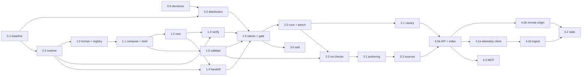

# Roadmap: phases and sub-phases

Status: DRAFT 2026-10-26. Proposed, not agreed with the maintainers. It replaces the five-row phase
sketch that used to live in the README. Settled decisions are only in the
[README decisions log](README.md#decisions-log); proposals are in
[00-requirements.md](00-requirements.md#proposed-decisions).

## TL;DR

Five phases. Phases 0 and 1 are the MVP: the core loop from the problem statement,
published so `npx quickstacks` works, with three bundled stacks that are sized to test
whether agents follow a 3,000-word brief as well as a 5,000-word one. After the MVP, the
order is proof, then reach, then scale:

1. Phase 2: stacks prove themselves. Recorded runs, a bench harness, a scheduled canary,
   and the deterministic checks that catch rot without an LLM. This is the product's CI,
   and it answers the assumption the problem statement says to test first.
2. Phase 3: existing repos and authors. `add`, personal and team stacks, authoring
   tools, git sources with a trust model.
3. Phase 4: the hosted side. An Effect API in `packages/api` that serves the registry index
   and run results, opt-in or opt-out usage telemetry (the maintainers' call), public stats, and an
   MCP server in `packages/mcp` once there is evidence agents want one.

Every sub-phase is one file in [phases/](phases/), sized for one agent in one session.

## How the files are numbered

`phases/phase-<phase>..md`. The phase number is the release-level grouping. The
sub-phase number starts at 0 in every phase, and `.0` is always the spine: the
sub-phase that every other one in the phase depends on (for phase 0 that is the set of
decisions and the name, for phase 1 the entry format and registry). Higher numbers are
not a strict order; the dependency graph below says what can run in parallel. A
sub-phase that turns out too big for one session splits by appending a letter
(`phase-1.3a.md`, `phase-1.3b.md`) so the numbers of its siblings never change, the
same way decision IDs never change.

Each sub-phase file opens with its `Status:` line, then a table of goal, trace,
dependencies and decisions, then scope, design, files touched, acceptance tests and
exit criteria. Exit criteria always include `bun run check` from the repo root.

## MVP cutline

The MVP is everything in phases 0 and 1, and nothing else. It is done when all of this
is true:

- `npx quickstacks@latest list --json` works on a machine with only Node installed.
- `quickstacks new <stack> <dir> --sandbox` writes the starter files, `.quickstacks/BRIEF.md`
  and `.quickstacks/manifest.json`, runs no command from any entry, and hands off to the
  agent on PATH, to the agent that called it, or prints the prompt.
- `quickstacks verify` runs the manifest's steps in phases, probes dev servers, always
  runs teardown, and fails (not warns) when the steps were changed since `new` wrote
  them (D14, proposed).
- `quickstacks validate` enforces the brief budget (D5) and the verify layers (D7) on the
  bundled registry, and the bundled registry passes it with zero errors.
- Each of the three bundled stacks has at least one recorded `new --sandbox` run that
  reached a green `verify` with no user intervention, with its time to green, verify
  count and brief size written down. One stack's composed brief is near 3,000 words and
  one is near the budget, so the long-brief assumption gets a first data point.

Below the cutline, on purpose: `add`, `show`, authoring skeletons, third-party sources,
the bench harness and canary, telemetry, the API and the MCP server.

## Phases and sub-phases

### Phase 0: foundation

Goal: the name is held, the decisions that are hard to reverse are made, the package
can be installed with `npx`, and the CLI base can run long and interactive commands.
No product behavior yet.

| Sub-phase | Goal | Traces to | Depends on | Status |
|---|---|---|---|---|
| [0.0 Decisions and name](phases/phase-0.0-decisions-and-npm-name.md) | `quickstacks` reserved on npm; D5-D9 and D12-D17 decided or deferred with a reason; first stack named | Open question "Is the npm name available?"; open questions on brief budget and registry audience | nothing | Not started (owner: maintainers) |
| [0.1 Repo baseline](phases/phase-0.1-repo-baseline.md) | The ported base, workspace move and review fixes committed, CI `ci-ok` green on `main` | "What has to be true for it to be worth building": a trustworthy base (D10, D11) | nothing | Mostly executed |
| [0.2 Distribution](phases/phase-0.2-npm-distribution-artifact.md) | A1 answered: a Node ESM bundle published to npm, a wider Node range, bundled assets found at runtime, e2e against the packed tarball | Open question on the npm name; the README's first command `npx quickstacks new` | 0.0 (A1, D12), 0.1 | Not started |
| [0.3 Command runtime](phases/phase-0.3-command-runtime.md) | A2-A4 answered: live progress on stderr, results that survive an expected failure, structured error details and exit 5, a process service with process groups, and a signal policy for interactive children | Agent as the main reader ("a verify command that doesn't exist", "ambiguity"); A2-A4 in [Open architecture questions](#open-architecture-questions) | 0.1 | Not started |

### Phase 1: the core loop (MVP)

Goal: an agent can run `list --json`, `new --sandbox`, read the brief and loop on
`verify` to green, on three bundled stacks, from the published package.

| Sub-phase | Goal | Traces to | Depends on | Status |
|---|---|---|---|---|
| [1.0 Entry format and registry](phases/phase-1.0-entry-format-and-registry.md) | `STACK.md`/`FRAGMENT.md` schema, origins (project, user, bundled) with trust marks, `list` and `list --json` | Job 5 ("a target I can verify against"); the agent "runs `list --json`, picks a stack" | 0.3 | Not started |
| [1.1 Composition and the brief](phases/phase-1.1-composition-and-brief.md) | Fragment composition, conditional prose, decisions, the commands map, and the brief with its word count | The brief "must say which layers of testing", "a default for every decision" | 1.0 | Not started |
| [1.2 `new`: scaffold and manifest](phases/phase-1.2-new-scaffold-and-manifest.md) | Files written with single ownership and JSON merge, templates with a fixed variable set, git init, the manifest with its step digest, `--sandbox`, `--with`, `--without`, `--yes`, `--no-launch` | Job 1, job 2; "writes a few files and a brief" | 1.1 | Not started |
| [1.3 `verify`](phases/phase-1.3-verify-and-tamper-detection.md) | Phased step runner, HTTP probes, teardown, built-in checks, tamper detection, local run records | "verify as the definition of done"; success rows 1-3 | 1.2 (manifest), 0.3 | Not started |
| [1.4 Handoff and entry points](phases/phase-1.4-handoff-and-entry-points.md) | Detect the calling agent, launch the agent on PATH with the signal policy, or print the prompt; the no-argument agent guide | Assumption "Handoff to whatever agent is on PATH" (D9) | 1.2, 0.3 | Not started |
| [1.5 `validate` and the brief budget](phases/phase-1.5-validate-and-brief-budget.md) | Format, composition and conditional checks; D5 budget; D7 verify layers; version-sensitive files and pinned versions in prose | Open question "What is the brief budget?"; success row 3 | 1.1 | Not started |
| [1.6 Bundled stacks and the MVP gate](phases/phase-1.6-bundled-stacks-and-mvp-gate.md) | Three stacks and their default fragments written to budget; one recorded green sandbox run each; first public release | Assumption 1 (brief size); success rows 1-3; D6 | 1.3, 1.4, 1.5, 0.2 | Not started |

### Phase 2: stacks that prove themselves

Goal: every bundled stack has a known last-green date tied to the exact content it ran,
a scheduled canary reruns them, and `validate` catches the kinds of rot that runs keep
finding, all without an LLM in CI.

| Sub-phase | Goal | Traces to | Depends on | Status |
|---|---|---|---|---|
| [2.0 Run records, fingerprint and bench](phases/phase-2.0-run-records-and-bench.md) | A run record schema, a content fingerprint per composition, a ledger, `quickstacks runs`, and a bench script that drives the user's own agent headlessly | "None of these are collected today"; success rows 1 and 2; assumption 1 | 1.6 | Not started |
| [2.1 The canary](phases/phase-2.1-scheduled-canary.md) | Scheduled bench runs of every bundled stack on a machine the maintainers control, with a report when a stack that passed stops passing | "How does a stack prove it still works?"; success row 4; assumption 2 | 2.0, D15 | Not started |
| [2.2 Deterministic rot checks](phases/phase-2.2-deterministic-rot-checks.md) | `validate` checks shipped files against the composition (commands, hook wiring, ports, import closure), flags dated prose, and reports "changed since last green" | Assumption 2 ("version-less prose rots much more slowly"); assumption 3 (verify keeps the agent honest) | 2.0 (fingerprint), 1.5 | Not started |

### Phase 3: existing repos and authors

Goal: jobs 3 and 4. A developer can add a known-good piece to a repo they already have,
and write their own stacks once, for themselves or their team.

| Sub-phase | Goal | Traces to | Depends on | Status |
|---|---|---|---|---|
| [3.0 `add`](phases/phase-3.0-add-fragments-to-repo.md) | Apply fragments to an existing repo without overwriting anything; parked copies in `incoming/` and a merge brief | Job 4; D4 | 1.6 | Not started |
| [3.1 Authoring](phases/phase-3.1-authoring-and-preview.md) | `show`, `create stack|fragment`, `validate --brief` preview, personal defaults (`always`), the authoring guide | Job 3; the stack author user; success row 5 | 1.5, 2.2 | Not started |
| [3.2 Git sources and trust](phases/phase-3.2-git-sources-and-trust.md) | `source add <git-url>` pinned to a commit, first-use listing of executables, update diffs, untrusted-until-confirmed | Success row 5 ("third-party sources"); the [Trust boundary](#trust-boundary) | 3.1 | Not started |

### Phase 4: the hosted side

Goal: what only a server can do. New and updated official stacks reach users without a
CLI release, real usage (if the maintainers agree to collect it) fills in the success table
across users rather than one machine, and agents can see which stacks work.

| Sub-phase | Goal | Traces to | Depends on | Status |
|---|---|---|---|---|
| [4.0a API foundation and registry index](phases/phase-4.0a-api-foundation-and-registry-index.md) | `packages/api` on Effect's HTTP modules with its own gate; shared schemas extracted to `packages/format`; a static, content-addressed registry index with each stack's last canary result | "Stacks don't rot" made visible; "the remote registry 404s today"; D11 | 2.1, 3.2, D16 | Not started |
| [4.0b The CLI's remote origin](phases/phase-4.0b-cli-remote-origin.md) | The CLI reads the index with a cache, bounded refresh, backoff and `--offline`, so official stacks update without a CLI release and `list --json` shows `lastRun` | "Stacks don't rot"; the agent's frustration with ambiguity | 4.0a | Not started |
| [4.1a Telemetry client](phases/phase-4.1a-telemetry-cli-client.md) | Consent, first-run notice, random ids outside the project, events, a spool, and failures that never touch command output | "None of these are collected today"; success rows 1, 2 and 5; D9 instrumentation | 4.0a, D17 | Not started |
| [4.1b Telemetry ingest](phases/phase-4.1b-telemetry-ingest-api.md) | Per-event validation, idempotency, normalizing unknown names to `custom`, recomputed verify outcomes, rate limits and caps, hashed networks, retention | Same as 4.1a | 4.0a, 4.1a's event schema, D17 | Not started |
| [4.2 Stats and directory](phases/phase-4.2-stats-and-directory.md) | Aggregates with small-cell suppression, a stats endpoint, `stats` in `list --json`, a static directory page | The agent picking a stack; success row 5 | 4.1b, 4.0b | Not started |
| [4.3 MCP server](phases/phase-4.3-mcp-server.md) | `packages/mcp` exposing list, show, new (no launch) and verify as tools over stdio, built on the CLI's `--json` contract | Assumption 5 (entry point); D11 | 4.0a, evidence from D9 | Not started, gated |

## Dependency graph

What can run in parallel, given one agent per sub-phase:

| Lane | Sub-phases | Shared files to watch |
|---|---|---|
| Phase 0 | 0.2 and 0.3 after 0.1 | `packages/cli/src/bin.ts` (0.2 adds a Node entry, 0.3 changes signal handling): land 0.3 first or agree the split in `platform/` |
| Phase 1, after 1.1 | 1.2 and 1.5 | `src/schemas/entry.ts` is read-only for both |
| Phase 1, after 1.2 | 1.3 and 1.4 | `src/errors.ts` (new tags) and `src/cli.ts` (subcommand list): additive, merge by hand |
| Phase 1, content | Stack prose for 1.6 can be drafted as soon as 1.0 fixes the format | Drafts are checked by `validate` once 1.5 lands |
| Phase 2 | 2.1 and 2.2 after 2.0 | none |
| Phase 3 | 3.0 runs alongside phase 2 | `src/core/scaffold.ts` (3.0 adds the parking path) |
| Phase 4 | 4.0b and 4.1a after 4.0a; 4.3 alongside them | `packages/format` |

## Why this order after the MVP

The problem statement ranks its users and names its riskiest assumption. The order
follows both.

Phase 2 goes first because it is the only phase that tests the product's two central
claims. Assumption 1 (agents follow a long brief) is the one the problem statement
says to test next and calls a one-way door. Assumption 2 (version-less prose rots
slowly) is the whole reason quickstacks beats a template. Today the only evidence for
either is a handful of runs by hand, and "two of the five stacks have not been taken to
a green `verify` by an agent since their last change". Without phase 2, every later
phase builds on stacks nobody knows still work. It also produces the first two rows of
the success table on one machine, with no telemetry decision needed. This is D8.

Phase 3 comes next because it serves jobs 3 and 4 and the fourth user, the stack
author, and it can run in parallel with phase 2 (it only needs the MVP). It is second
rather than first because the problem statement rates "users want to bring their own
stacks" low confidence, with one known user, while jobs 1, 2 and 5 are what the MVP
already serves. Shipping `add` before the canary would widen the surface that can rot
before there is anything to notice the rot.

Phase 4 is last because its value depends on assumptions the problem statement rates
lowest: that a community registry forms ("None; the remote registry 404s today") and
that people other than the author will use it. It is also the only phase that adds a
service to run and pay for, and a privacy promise to keep. The canary's results and
git sources (phase 2 and 3) give it something real to serve when it starts.

## Measurement and the canary

The problem statement says the canary "is the product's CI and probably belongs
earlier". This plan agrees with the reasoning and puts it at the start of the phase right
after the MVP, not inside the MVP. Three reasons:

1. The MVP gate already requires a recorded green run per bundled stack (1.6), so the
   MVP ships with the same signal a first canary run would give.
2. A canary pays off through repetition: "a stack that passed last month still passes
   this month". The first month after release is when the stacks are least likely to
   have rotted, and the scheduler, credentials and reporting are a sub-phase of work
   that would push the first release back without changing what it knows.
3. The MVP lays the parts the canary needs: verify writes run records (1.3) and the
   manifest records what was composed (1.2). Phase 2.0 adds the fingerprint and bench,
   and 2.1 only schedules it.

Measures, and where each first gets a number:

| Outcome | Measure | First number from | Across users from |
|---|---|---|---|
| The agent finishes without help | Share of sandbox runs green with zero interventions | 1.6 gate runs (by hand), then 2.0 bench | 4.1 telemetry, if agreed |
| It's faster than by hand | Median minutes from `new` to first green `verify` | 1.3 run records | 4.1 |
| The result is complete | Shipped stacks whose verify covers D7's layers | 1.5 `validate` | n/a |
| Stacks don't rot | Green last month and this month with no prose change | 2.1 canary | 4.0 publishes it |
| People write their own | Stacks in user directories and git sources | 3.2 (sources exist to count) | 4.1 (`custom` counts only) |

An intervention is any message from the user to the agent after the handoff prompt.
Headless bench runs have zero by construction, so the bench measures "finishes without
help" directly. Interactive runs rely on the brief's rule that the agent logs every
question it asks the user under `Asked` in `.quickstacks/NOTES.md`; `quickstacks runs`
counts those lines (2.0).

## Contracts every sub-phase shares

These are fixed here so parallel sub-phases agree. A sub-phase that needs to change one
updates this table in the same change.

| Thing | Contract | Settled in |
|---|---|---|
| Project metadata | `.quickstacks/` at the project root. Committed: `manifest.json`, `.gitignore`, and project-local `stacks/` and `fragments/`. Ignored by that `.gitignore`: `BRIEF.md`, `NOTES.md`, `state/`, `incoming/` | 1.2 |
| State outside the project | `$XDG_STATE_HOME/quickstacks/projects/<projectId>.json`: the second copy of the step digest, first-green time. Optional: when it can't be written (sandboxed home), commands still work and say `stateRecord: false` | 1.2, read by 1.3 and 2.0 |
| Entry directories | `stacks/<id>/STACK.md`, `fragments/<id>/FRAGMENT.md`, optional `files/` and `adapters/<agent>/` | 1.0 |
| Origins, highest first | project (`./.quickstacks/{stacks,fragments}/`), user (`$XDG_CONFIG_HOME/quickstacks/{stacks,fragments}/`), git sources (3.2), remote index (4.0), bundled (inside the npm package). A project-local entry with a new id is trusted; one that shadows an id from a lower origin is not. Git sources are untrusted until confirmed (3.2), and so is an index at a non-default `QUICKSTACKS_INDEX_URL` (4.0b) | 1.0, extended in 3.2 and 4.0 |
| Bundled registry in the repo | `packages/cli/registry/`, shipped in the package and found at runtime by the platform entry, not by core code | 0.2, 1.0 |
| Prose markers | `<!-- quickstacks:when key=value -->` ... `<!-- quickstacks:end -->` for conditional prose; `quickstacks:fill` for text the agent must replace | 1.1 |
| Exit codes | The base's table plus 5 for `VerifyFailed` and `VerifyChanged`. Usage, input and not found stay 2, joined by `EntryInvalid` (1.0), `ComposeConflict` (1.1), `TargetNotEmpty` (1.2) and `ValidationFailed` (1.5, keeps its report like verify) | 0.3, 1.0-1.3 |
| JSON contract | One result on stdout. A failure that carries a report (verify) keeps that result on stdout and still writes the error envelope as the last stderr line. Error envelope gains an optional closed `details` object. A `--only` or `--skip-tag` verify run that passes exits 0 with outcome `partial`, which never counts as green | 0.3, 1.3 |
| Environment | Only `config.ts` reads env, including agent markers and `PATH`. Only `bin.ts` and `src/platform/` touch Bun or Node process APIs | base, 0.2, 0.3 |
| What the CLI executes | Its own git and process calls, and the steps of the project's manifest under `verify`. Never a command while reading, composing or writing an entry (D2) | [Trust boundary](#trust-boundary) below |
| Manifest fields added later | `handoff` (1.4), `fingerprint` (2.0); `createdAt` and `briefWords` from 1.2 are what `runs` reads (2.0) | 1.2, 1.4, 2.0 |
| Verify step `layer` | One of `install`, `lint`, `typecheck`, `test`, `build`, `serve`, `docs`. D7 enforcement (1.5) and run records rely on it | 1.0 |
| Settings additions | `always`, `agents` and `author` in `config.json`, still rejecting excess properties; `sources` in 3.2, with checkouts under `$XDG_DATA_HOME/quickstacks/sources/` | 1.1, 1.4, 3.2 |
| `validate` severities | `error` (exit 2), `warning` (fails the bundled registry's zero-warning gate), `note` (never affects exit or the gate; 2.2) | 1.5, 2.2 |
| Run evidence | Gate and bench run notes in `plans/runs/<date>-<stack>.md`; the ledger at `packages/cli/registry/runs.json`, which 4.0 publishes | 1.6, 2.0 |
| New dependency | `yaml` for frontmatter, added in 1.0. Any other new runtime dependency needs a line in that sub-phase's design saying why the standard library and Effect aren't enough | 1.0 |

## Repository and stack

The code-level reference is the repo's `AGENTS.md`; this section keeps only the facts
the plan depends on and why they were chosen.

The stack is settled (D10): a TypeScript CLI on the `typescript-cli` base, with the base's
required and default pieces (the `.claude/` harness and hook tests, lefthook with
Conventional Commits, GitHub CI, Effect guidance) and none of the optional ones. The
model-provider chat app, the Bun release pipeline, remote test execution and the
plugin bundle were left out because a CLI that never calls an LLM (D2) has no use for
them; the release pipeline comes back only if A1 picks compiled binaries. One leftover
error for invalid model output was removed, and exit code 5 was left unassigned rather
than renumbering the others. Phase 0.3 gives it to `VerifyFailed`.

What the base gives the product, and why it fits:

| Area | What the base does | Why it matters for quickstacks |
|---|---|---|
| Program structure | Effect commands from `effect/cli`, namespaced `Context.Service` classes with static layers, one invocation per layer build, lazy config | Each command is testable through the real parser without module mocks |
| Output | Results on stdout, diagnostics on stderr, `--json` on every command, stdout cleared on failure, the last stderr line a JSON `{ error: { tag, message, retryable } }` | The coding agent is the main reader |
| Exit codes | Usage, input and not found 2; config 3; upstream 4; permission 6; interrupted 130; defect 1; broken pipe quiet 0 | Agents branch on exit codes, so they never change once published |
| Config | Env read only in `config.ts`; XDG paths; `doctor` and `--version` survive a broken config file | The user directory of stacks lives under XDG |
| Logging | Structured records, an optional JSONL file, one `command` record per invocation, no argument values or secrets | Run records (1.3, 2.0) follow the same rules |
| Boundaries | A Grit plugin and `guard-boundaries` keep Bun in `bin.ts` and `src/platform/`, env in `config.ts`, and console and stdout out of application code | The rules the Node entry (0.2) and the process service (0.3) have to respect |
| Tests | Vitest on Node over the real command tree via `tests/helpers/cli.ts` with temporary HOME and XDG; `bun test ./e2e` only for the built artifact | Every sub-phase's acceptance tests use these two layers |

The repository layout is settled (D11; see the README log for its current wording): a
bun workspace over `packages/*`. `packages/cli` is the `quickstacks` package.
`packages/api` and `packages/mcp` exist as placeholders and get their real contents,
tests and gate in 4.0 and 4.3. Code that two packages need goes in its own package,
extracted when the second one needs it: the entry, manifest and run-record schemas move
to `packages/format` in 4.0, not before. The root owns the harness
(`.claude/`, `tests/hooks/`, lefthook, CI), `biome.json`, `tsconfig.base.json`, and
scripts that fan out with `bun run --filter '*'`. Root `dev` uses `--cwd packages/cli`
because `--filter` prefixes output lines and would break `--json`. Shared dependency
versions live once in the root workspace catalog. A new package brings its own
`.claude/rules/<package>/` directory and, if it needs one, its own boundary guard.

The 2026-10-26 foundation review fixed these before any product code: defects are not
retryable and log their class and stack frames but not their message; `--json` after
`--` belongs to the command; config paths follow `XDG_DATA_HOME` and `XDG_CACHE_HOME`;
CI runs on Linux and macOS behind one `ci-ok`; e2e and Grit probes resolve paths from
their own file. Three findings were product design and are A2-A4 below.

## Open architecture questions

Each has an owner sub-phase that must answer it before dependent work starts. When an
answer is agreed it becomes a decision in the README log and the sub-phase records it.

| ID | Question | Options | Recommendation | Answered in |
|---|---|---|---|---|
| A1 | Distribution. The base compiles one Bun binary, but the problem statement's entry point is `npx quickstacks new`, which runs an npm package under Node | (a) Publish a Node ESM bundle to npm; keep the compiled binary as a test artifact or drop it. (b) Per-platform compiled binaries behind an npm wrapper, which brings signing and notarization. (c) Binary only via curl or Homebrew, which breaks `npx` and the "ask your agent" entry point | (a): one artifact that works wherever Node does, and core code already must run unchanged under Node | [0.2](phases/phase-0.2-npm-distribution-artifact.md) |
| A2 | Streaming output. Output and the logger buffer everything until the command ends | (a) NDJSON events on stdout in `--json` mode. (b) One result at the end, live progress on stderr in human mode only | (b): keeps "JSON commands produce one result", and agents' shell tools capture whole output anyway | [0.3](phases/phase-0.3-command-runtime.md) |
| A3 | Signals during handoff. `bin.ts` turns SIGINT and SIGTERM into an interrupt of the whole program, but Ctrl+C during handoff belongs to the agent | (a) `exec` into the agent (Node can't). (b) Spawn the agent with inherited stdio, ignore SIGINT and SIGQUIT while it runs, forward SIGTERM and SIGHUP, exit with its status | (b), with output flushed before the spawn | [0.3](phases/phase-0.3-command-runtime.md), used by [1.4](phases/phase-1.4-handoff-and-entry-points.md) |
| A4 | Structured errors. Errors are fixed messages with no fields; a failing verify needs the step, its command and exit code | (a) Schema fields on tagged errors and a closed `details` object in the envelope, with `VerifyFailed` on exit 5. (b) Put failure data only in the result | (a) plus keeping verify's report on stdout; exit and retryable tables become one table | [0.3](phases/phase-0.3-command-runtime.md) |

## Trust boundary

D2 says the CLI never runs a command from a stack entry, and `verify` runs commands that
started life as an entry's verify steps. The two are reconciled by where the command
lives when it runs, and by who can see it first.

- `list`, `show`, `new`, `add` and `validate` read, compose and write entries. They
  execute nothing an entry names: no generators, no install scripts, no hooks, no verify
  steps. The only processes they start are the CLI's own (`git init`, a PATH lookup, and
  the agent at handoff, which the user already chose to install).
- `new` copies the composed steps into `.quickstacks/manifest.json`. From then on they
  are project state: a file in the user's repo they can read, diff and commit, like a
  `Makefile`.
- `verify` runs only the steps in the manifest of the project it is pointed at, prints
  each command before running it, and runs nothing else. Running it is the same trust
  decision as running `make test` in that repo.
- Entries keep shell to a minimum: a verify step's `run` should call a project command
  (`make test`, `bun run lint`), and file checks such as "README filled in" are built-in
  check kinds the CLI evaluates itself, so an entry never needs to ship a raw shell
  pipeline for them (1.0, 1.3).
- Changed steps fail verify (D14, proposed). This guards against an agent weakening the
  definition of done to finish, not against an attacker who controls the machine. What
  it cannot catch, a project command the agent turned into a no-op, is handled by the
  brief's rules, the D7 layers, and inspection of bench runs (2.0).
- Untrusted origins: a project-local entry that shadows a known id is marked
  `trusted: false`. `new` then never launches an agent, and the brief and the printed
  next step tell the reader to get the user's confirmation. Git sources (3.2) are
  untrusted until the user confirms the pinned commit after seeing every executable
  file it would write.

## Decisions and open architecture questions by sub-phase

| ID | What | Must be decided before | Status |
|---|---|---|---|
| A1 | Distribution | 0.2 | Open, recommendation [above](#open-architecture-questions) |
| A2 | Streaming output | 0.3 (needed by 1.3) | Open, recommendation in 0.3 |
| A3 | Signals during handoff | 0.3 (needed by 1.4) | Open, recommendation in 0.3 |
| A4 | Structured errors | 0.3 (needed by 1.3) | Open, recommendation in 0.3 |
| D5 | Brief budget | 1.5, and before 1.6 writes stack prose | Proposed |
| D6 | Bundled registry audience | 1.6 | Proposed |
| D7 | Verify layers per stack | 1.5 | Proposed |
| D8 | Canary right after the MVP | Phase 2 start | Proposed, this roadmap assumes yes |
| D9 | Both entry points, instrumented | 1.4 | Proposed |
| D12 | Node range for the npm package | 0.2 | Proposed |
| D13 | The three MVP stacks | 1.6 (drafting can start after 1.0) | Proposed |
| D14 | Changed verify steps fail verify | 1.3 | Proposed |
| D15 | Where the canary runs and on whose agent account | 2.1 | Proposed |
| D16 | API hosting | 4.0 | Proposed |
| D17 | Telemetry consent model | 4.1 | Proposed; also open question 5 in 10 |

## Competitive landscape, in one paragraph

Researched 2026-10-26; the table with sources is in
[00-requirements.md](00-requirements.md#what-were-replacing). Nothing found combines a
version-less project description, the user's own agent, an executable definition of
done, and detection of a weakened gate. Template tools (Copier, cookiecutter, Yeoman,
`create-*`, Projen) freeze versions at authoring time; Copier's `update` is the best of
them and still has no gate saying the result works. Spec-driven kits (GitHub Spec Kit,
Kiro, BMAD, Agent OS, Tessl) work per feature rather than per project bootstrap, and in
each one the model decides when it is done. AGENTS.md is the convention agents already
read for build and test commands, so stacks should write one rather than compete with
it. Three patterns to copy: `init --agent <name>` style flags and a non-interactive
`-y`, a stored record of inputs that machines can check (Copier's answers file), and a
static, URL-addressable registry (shadcn's registry JSON).

## Won't have in this roadmap

| Idea | Why not now |
|---|---|
| A two-phase brief for an "app" built on a stack | The budget (D5) and optional fragments are the first tools against brief growth. Revisit if a stack can't fit its proving slice in budget |
| Dependency-version telemetry or an ecosystem trends site | Measures the registry back to itself while there are a handful of stacks, and widens the privacy surface. Not needed by any success measure |
| Fetching the registry from a git branch on every run | Behavior would change under a fixed CLI version. Phase 4.0 serves a versioned index instead |
| Native config for agents other than Claude Code | AGENTS.md covers every agent. Add `adapters/<agent>/` content when a stack author needs it and the agent's format is documented |
| Ratings, reviews, accounts | Gameable, need moderation, and verify outcomes answer "does it work" better |
| Field notes (dated, expiring findings in briefs) | Useful, but the Build workarounds section in each generated project covers it until the canary shows the need |
| Hooks into spec-driven workflows | A project quickstacks builds already has AGENTS.md; a spec kit can start from there |
